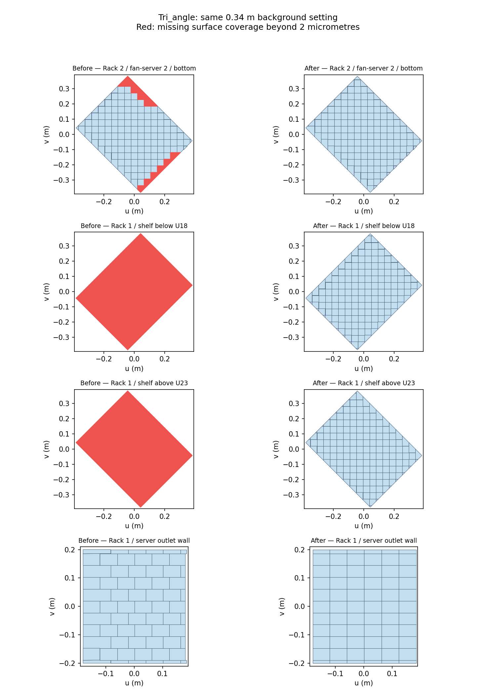

# Tri_angle 机柜网格修复（2026-09-11）

当前工作目录为 `/mnt/lv/home/litianyu/mycode/dcdtuni/case/Tri_angle`。已将经过验证的 **0.17 m、4 分区、271,187 单元**网格安装到该目录的 `Mesh/`。HTML 和 React 共用此后端与 dcCartMesh，无需修改前端网格按钮。

本次处理了三个问题：Rack 2 的 `fan-server_2` 底面缺口、Rack 1 两块内部隔板消失，以及服务器进出口表面的交错竖线。

| 用户位置 | OpenFOAM patch |
| --- | --- |
| Rack 2 / fan-server_2 底面 | `Default_Rack_2_fan_server_2_bottom` |
| Rack 1 / U18 底部 | `Default_Rack_1_u17_partition_master`、`_slave` |
| Rack 1 / U23 顶部 | `Default_Rack_1_u23_partition_master`、`_slave` |

图中两列使用相同的 0.34 m 输入，红色表示超过 2 μm 公差的未覆盖区域。当前安装网格使用用户后来设置的 0.17 m，另外进行了验证。

服务器 STL 省略了归属于机柜的侧壁，原有可达性分类在这种开口壳体的边角会判断错误。现在对矩形服务器识别其实体范围，并在切割前完整处理服务器和机柜面的平面；原始 STL 的面与 patch 归属得到保留。

内部隔板是零厚度面，不能作为实体挖除。后端为每块隔板准备独立 faceZone，并通过 `wallBaffle true` 让 dcCart 在单元合并前直接生成两侧 wall。两侧可以独立合并，不再受临时 cyclic 配对的约束。机柜薄板使用精确轮廓裁剪，取消其边角的面积重分类与宽松吸附；多孔边界仍由外部 createBaffles 处理。

交错竖线来自合并顺序：首选邻居在本轮被占用时，旧逻辑立即选另一个方向。现在等待下一轮重新判断。合并也不能再为了达到体积目标而引入超限 skewness；删除阈值从原始六面体体积的 0.005 降到 1e-6，并保留接触挡板的单元。质量检查按实际可合并的面片计算，补齐悬挂边顶点，对极细长的边角棱柱沿长方向细分，保持物理边界位置。

| 指标 | 修复前 0.34 m | 修复后 0.34 m | 当前 0.17 m |
| --- | ---: | ---: | ---: |
| 单元数 | 47,544 | 47,776 | 271,187 |
| 最大 skewness | 54.6972 | 3.98808 | 3.98271 |
| 最大非正交角 | 74.2679° | 74.2679° | 74.5550° |
| 平均非正交角 | 13.3213° | 13.7452° | 11.2742° |
| 最大长宽比 | 48.3083 | 210.450 | 773.763 |
| 最小单元体积（m³） | 2.87585e-8 | 1.6476e-9 | 8.8308e-12 |
| checkMesh | 未通过 | Mesh OK | Mesh OK |

保留正确的小单元会降低最小体积，表面竖线对齐也不代表所有内部切割单元都正交。这里报告各项实际指标，没有放宽 checkMesh 的验收阈值。

0.34 m 回归中，服务器底面未覆盖面积从约 **0.02450 m²** 降至 **1.15e-7 m²**；两块原先完全缺失的隔板均恢复，单侧面积约 **0.288 m²**。0.17 m 同样检查了底面、两块隔板两侧以及三台服务器的全部进出口面。

验证包括：

- 13 项原生 OpenFOAM 回归通过，覆盖 0.34 m 单核/四核、0.17 m 四核、面覆盖、全部进出口列对齐和最终质量报告。
- 补充的 0.17 m 单核结果同为 271,187 单元，质量指标与四核一致。
- 59 项相关后端测试通过，2 项根据既有案例条件跳过。
- 最终 0.17 m 网格在临时副本完成 100 步求解，约 26 秒；结果保留在 processor 目录，由原生 OpenFOAM reader 读取。T、U、p_rgh、k、epsilon 均为有限值。

100 步属于运行检查，不是完整稳态收敛或物理精度验证。手动修改验证 manifest 时，必须同步顶层与 `meshGeometry` 中的配置；排查中一次仅修改顶层配置的运行沿用了旧参数，在 435 步收敛，未作为 100 步验证结果。

DAML-Testbed 的附加复查未标为全通过：当前旧网格有 479 个拓扑开口单元和 195 个高 skewness 面；新流程的临时副本仍有 2 个拓扑开口单元、2 个高 skewness 面（最大 9.16805）。此处仅记录结果，本次交付的完整通过结论针对 Tri_angle。

机器可读数据见 [验证数据](assets/tri-angle-mesh-validation.json)。冻结的输入及复现命令见 [回归输入说明](../../../src/backend/tests/fixtures/dccart_tri_angle/README.md)。

更新前的当前网格已备份至：

`case/Tri_angle/log/mesh-before-tri-angle-fix-20260911-113035.tar.gz`

当前 `Mesh/` 已与经过验证的网格逐文件核对一致。重新加载网页网格预览即可读取新网格；预览缓存会按各分区网格文件的时间和大小失效。
