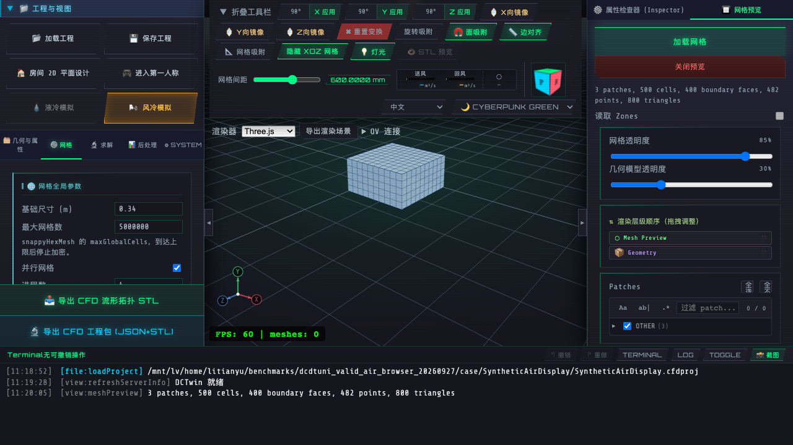
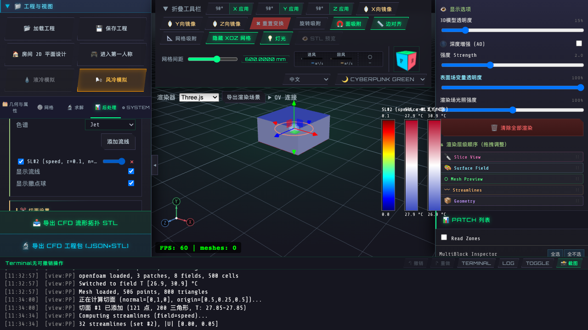
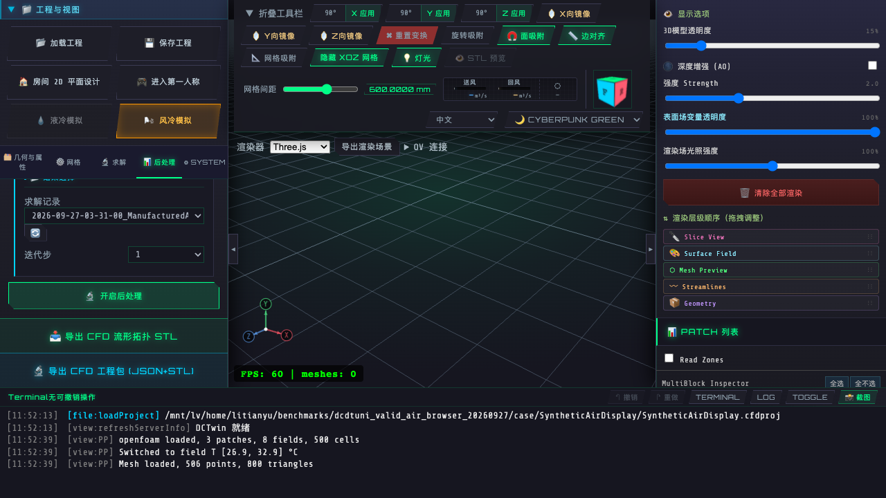

# 风冷后处理选定时间与浏览器显示验收（CPU，2026-09-27）

在 40901 非 NSCC 主机的独立工作树 `/mnt/lv/home/litianyu/benchmarks/dcdtuni_valid_air_browser_20260927`，通过仓库唯一启动器在独立端口运行 React 生产构建，使用正常开发账号完成浏览器登录。原 Shinaide 工程、既有 8360 服务和 GPU/Kit 均未使用。浏览器测试仅针对风冷显示与选定时间的数据契约。

测试工程 `case/SyntheticAirDisplay/SyntheticAirDisplay.cfdproj` 是独立的合成显示案例，房间范围与 1×0.5×1 m OpenFOAM 小盒一致。网格来自自有 `dcdtuni_shinaide_hybrid_heat_bound_20260927/quality-box` 正向控制，隔离副本的 `checkMesh -allTopology -allGeometry` 报告 **Mesh OK.**，500 cells；`Mesh` 与显示运行目录的五份 `polyMesh` 文件逐字节相同。为避免冒充真实求解结果，显示运行 `2026-09-27-03-31-00_ManufacturedAirDisplay` 的 `PROVENANCE.json` 明确标注：第 1、2 帧 T/U 是手工制造的均匀场，分别为 T=301/303 K、内部 U=(0.05/0.10,0,0) m/s；**没有对这两个场运行 CFD，也不代表 Shinaide 或 NV 预测**。原正例目录的旧 `3102/T` 只有 10 个单元值，与后来保存的 500-cell 网格不匹配，不能用于场渲染验收。

修复前：在真实 React 页面选择第 1 帧并再次点击“开启后处理”，界面仍显示第 2 帧的温度范围 `[26.9,32.9] °C`。前端 `pp.initRun` 只发送 `runDir`，后端缓存仅以运行目录为键，读取器默认选择最新帧。修复后，显式 `timeValue` 从界面传到 `/api/pp/init` 和原生 OpenFOAM 读取器；缓存区分请求时间。第 1 帧请求/响应均为 `timeValue:1`、`cached:false`，温度范围变为 `[26.9,30.9] °C`；请求不存在的第 999 帧返回 HTTP 400 和可用时间 `[0,1,2]`，不回退至最新帧。显式选择第 0 帧返回 `timeValue:0`。

浏览器还实际加载网格预览（3 patches、500 cells、400 boundary faces、482 points、800 triangles）；在第 1 帧渲染 T，Y=0.25 m 切片产生 121 点/200 三角形、27.85 °C；16 个种子生成 32 条流线，速度上限 0.05 m/s。切到第 2 帧并重新生成后，速度上限为 0.10 m/s。这些数值仅验证原生读取、时间选择、切片/流线 API 和 Three.js 显示链路。选择新时间或新运行目录立即清除旧场和已生成的切片/流线；当前还须点击“开启后处理”应用新选择，加载期间两个选择器禁用。缺步请求在替换后端缓存前被拒绝，已加载的上一有效帧仍可读取。

回归：最终 React 全套 255 文件/2638 项通过、生产构建通过；最终 Mac 与 40901 相关后端各 29 项通过。同轮 Mac 后端全套在最后一处缓存预检调整之前曾得 1606 pass、40 skip、10 fail，失败涉及旧 ODIL 热环、meshgen、polyMesh fixture、房间封闭与模板测试；该结果不外推为最终全仓库回归，故不能宣称全仓库绿。机器可读来源哈希及浏览器数值见同名 JSON。

筛选失败案例未被冒充为正例：Tri_angle 严格检查失败 6 项，Slab 失败 5 项，Polygon_Room 失败 2 项；旧 10-cell 热通量正例严格检查失败 1 项。普通 `checkMesh` 的 `Mesh OK` 或进程退出码 0 均不替代本次严格质量报告。

**尚存跨标签竞态**：后处理器是进程级单例。标签 A 初始化第 1 帧后，标签 B 若初始化第 2 帧，A 随后的 `/api/pp/mesh`、`/api/pp/field`、切片或流线请求没有携带 run/time/revision，可能读到 B 的帧。此问题原先也存在于不同运行目录间；本提交只保证单标签按选定时间读数及本地切换不显示旧场。多标签严格隔离需要独立的请求级来源版本门禁与后端读取锁，不应把这里的单标签证据外推为无竞态。
