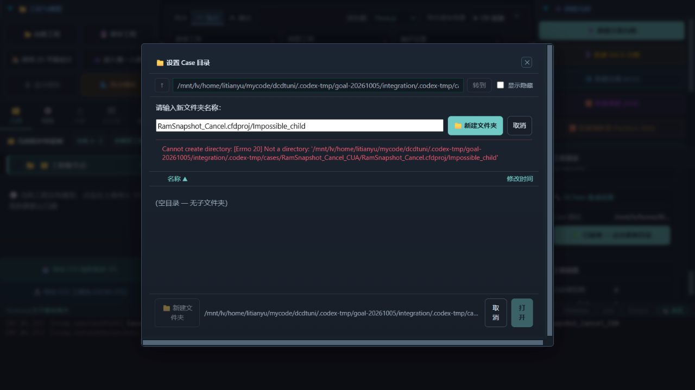
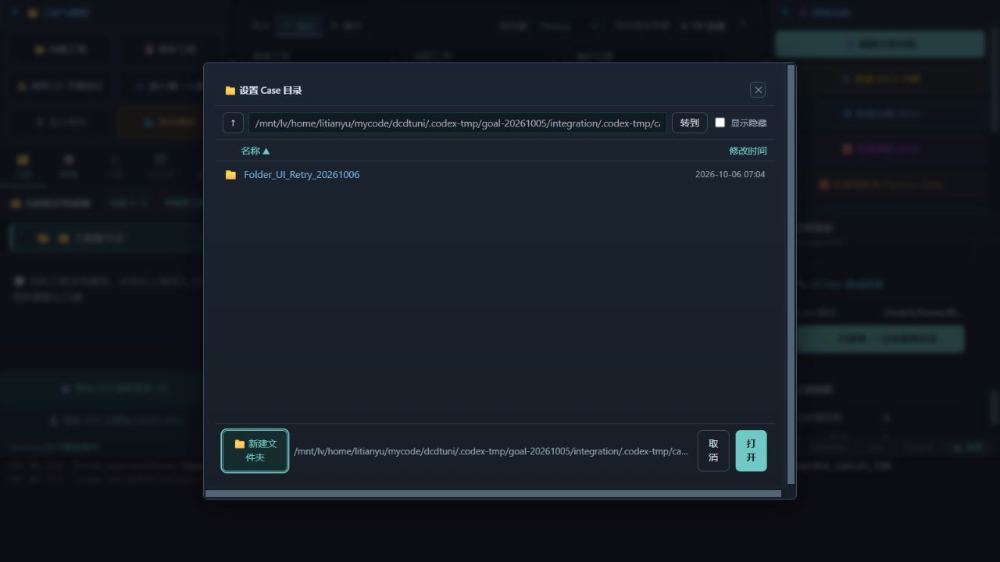

# React 新建文件夹修复与 IT 浏览器验收（2026-10-06）

“设置 Case 目录”内的“📁 新建文件夹”已经在正常 IT 构建页面通过真实浏览器验收。创建流程使用页面内的 React 名称输入表单；失败显示服务器错误并保留输入，用户可直接修改后重试。Esc 关闭名称表单，父目录窗口仍保持打开。该切片没有改变目录API、cfdproj/cfdrun schema或风/液业务入口。

## 原始故障与源码身份

ROOT 在 2026-10-05T22:47:06.376Z 于正常内置浏览器点击新建按钮，实际错误为 `Error: prompt() is not supported`，旧 bundle 为 index-AWScKNyD。原始文字、堆栈和完整浏览器证据保存在 source/ROOT-browser-*，原RED原样保留。SaveAs 新目录 workaround 不能算此按钮通过。

只修改了 FileBrowser.tsx 和既有 FileBrowserInteractions.test.tsx。组件增加有标签、自动聚焦的名称输入、创建/取消、可见错误；同步重复提交门防止pending期间重复POST，成功后刷新当时父目录列表并恢复按钮焦点，空白名称不提交。既有 createRemoteDirectory API与fileBrowserModel均字节不变；沒有新第三方依赖。输入中的路径分隔符仍按既有API处理，没有增加schema规则。

| 文件 | SHA256 |
|---|---|
| FileBrowser.tsx（15,938 B） | 8ce343b0fc8bc5e7c7182a8553450ff626f1dbf7e67f93bc776d95099b4a5333 |
| FileBrowserInteractions.test.tsx（9,821 B） | f8cff40d59b35a3bc4446116dba968c7327aa0fc5f4c59377d2ef71414437508 |

源码作者包 manifest：a03c6807a896a8672601253ff293fc535e311915facdb58929fba9571adcf3ea，29 payload / 1,394,474 B。ROOT 独立阅读两文件完整差分并核全包身份，接受 normal IT build；依据 build/root-source-acceptance.json。本目录打包者也是源码作者，因此不把此文档整理当独立源码复审。

## RED、单位测试与构建

同一mounted FileBrowser、真实createRemoteDirectory adapter，以抛出实际prompt错误的旧组件先跑6个新负例：6 FAIL，既有5 PASS，6项预期unhandled prompt错误原样保留。canonical test pre-product与最终文件完全相同。修复后两个相关文件共23 PASS，tsc --noEmit退出0；焦点收口后的最后一次23 PASS耗时5.163 s、tsc耗时22.060 s。首轮和末轮不是可相加的测试总数；这里只报告末轮。未以单位测试冒称真实UI验收。

ROOT 对冻结21源执行一次正常 IT `npm run build`（内含tsc -b），返回0，46.537 s，产生 index-Bh3uEUXL.js（2,956,083 B，SHA256 8eb4f27b159e6699980cc49d1ce5c860f0164041fcb16f4b8969ab4c72ad0096）。before/after记录绑定了上表两个源SHA。build/保留顶层命令、原始build.log、before/after、dist inventory和资产恢复证据；没有复制17 MB dist-before备份、tmp或cache。原build manifest的BOX/CDU/OV字段是同次构建依赖，FileBrowser本身由root-source-acceptance与before/after直接绑定。

正常构建包manifest：a836c4d7e963589088fd6b9c3ae8757cc5a3b4cb5c6afecc06552386368ceee9。原build receipt记录21源、6进程/5监听及旧资产保护未变；此整理不再触碰服务、浏览器或构建。

## ROOT 真实浏览器验收

时间起点 2026-10-05T23:04:33.277Z（SGT 2026-10-06 07:04），正常 IT 页面 http://10.96.72.147:8396/，实际脚本 index-Bh3uEUXL.js。ROOT操作及原始AX/截图在 runtime/。

- 点击按钮显示名称表单；有标签的输入获得焦点。
- Esc 取消表单，导航恢复，焦点返回新建按钮；取消名称没有生成目录。
- 输入 RamSnapshot_Cancel.cfdproj/Impossible_child，真实服务器返回 Not a directory；可见错误与原输入保留。
- 修改后重试 Folder_UI_Retry_20261006，目录出现在当前父目录列表，表单关闭，按钮焦点恢复。
- 取消父窗口，新 console errors=[]。该proof tab没有切换Case目录或启动求解。

静态JPEG已由整理者实际查看：下图分别明确显示保输入错误与创建成功列表。查看的是ROOT冻结截图，没有新的浏览器操作。

runtime manifest：02b49650c2fba673128ba20f595f3064deb2911391a5bd56faeac4292cd3c1b6，5 payload / 359,469 B；原byte完整复制，含proof-only cfdproj。该cfdproj为验收证据，不能当物理求解结果。

## 状态与交接边界

这是IT新UI的验收。按ROOT安排本次文档任务时给出的状态，当前MAIN页面仍保留先前已加载的OV viewer；不把IT browser通过说成MAIN页面已经更新或切换验收。主路线的顶部栏、cube/轴、OV、全案例网格/风液求解仍按各自回执和主任务推进，不能由本按钮切片推导完成。

source/29、build/13顶层、runtime/5原payload和三个原manifest均SHA-preserved复制。publication-verification.json记录逐项来源和复制身份；本目录manifest.json冻结47 payload+3原manifest+文档/复制证明，不包含distbackup/tmp/cache。只新增此docs目录；既有HANDOFF未修改，建议文字在HANDOFF-draft.md，由ROOT确认后并入。
