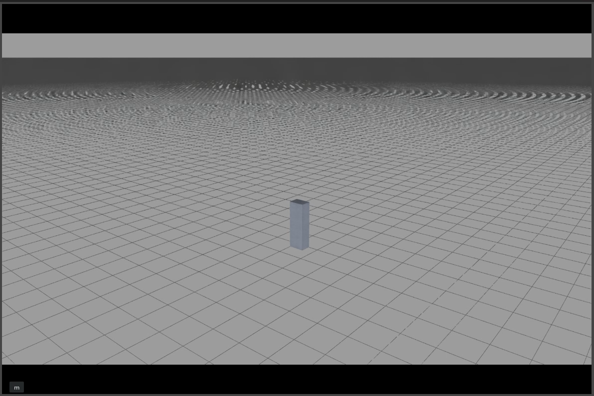

# Native OV background grid: observed display and remaining limits

The normal React renderer selector was used in the Windows Codex in-app browser against the owned 40901 service on port 8396. The ordinary one-BOX engineering file was loaded using the shared project browser; no browser debug RPC, injected store, or separate OV UI was used.

The actual video was live (1192 x 796, readyState 4, paused false), with 60/61 presented frames per second. The common view control visibly removed and restored the native background lines. Changing grid spacing from 600 to 1000 mm visibly changed their spacing after the asynchronous render update. The persisted ordinary GUI screenshot below includes the 1000 mm control and visible FPS. Folding the toolbar retained the view cube and axis widget.

The native geometry uses its measured viewport image resolution and complete source/frame matrix comparison. Both unchanged GL and the fixed reversed-depth transformation z=(w-z_GL)/2 are accepted jointly for projection and world matrices. Near/far clipping, camera/source identity, closing checks, and decoded-parity refusal remain intact. CPU independent replay verified 83 frozen files and all 21 planned outcomes, including the old reversed-depth rejection. The new normal regression checks every entry in real Gf camera matrices, mixed conventions, malformed samples and clip-plane equivalence. Normal USD/background-grid/depth tests: 28 passed, 4 subtests passed.

This is visible native decoration evidence. Encoded pixel parity and the inner viewport-to-stream mapping remain unresolved; the UI continues to report that limit. The camera preset/collapsed-toolbar transition still showed a pending grid banner and needs further validation. There is a bottom black strip in the native video. CDU/BOX Shift selection, roof opacity/material fidelity and fresh-clone OV runtime are separate unfinished acceptance items.

Native diagnostic logging was explicitly enabled only for this owned debug instance and remains off by default. No mesh/solver permission or quality result is granted by these display observations. The original standalone USD helper tests also exposed an unconditional native-package import when no native carrier was supplied; the import is now conditional, retaining the existing standalone authoring path.
