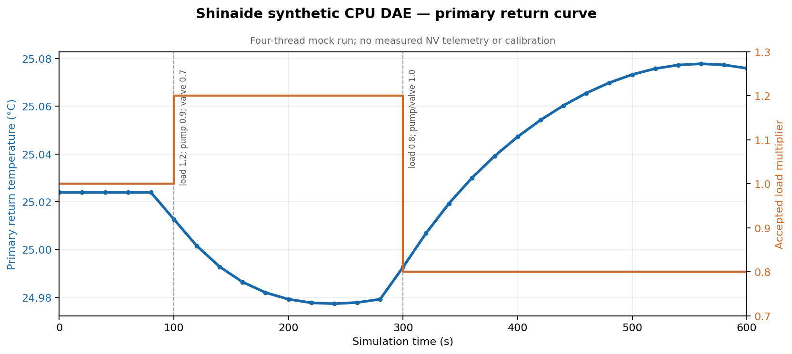

# Shinaide 风液热量交接 CPU 验证（2026-09-27）

本次从保存的 `Shinaide_dae_cpu.cfdproj` **派生**独立 mock 工程，原始 Shinaide 文件与保存的 DAE 工程均未改动。派生工程以 `.cfdproj` 为唯一可编辑真源，由现有 React 三维导出器生成 v3 `.liquidrun`、v2 `.cfdrun` 与 12 份 grouped STL。风侧 `sourceProject.contentHash`、液侧 `source_project.sha256` 和后端重算的工程规范哈希相同；风侧清单同时保存了 12 份 STL 的导出时 SHA-256，逐文件与传入后端的字节一致。STL 与先前风冷网格所用文件也逐字节一致。mock 中 56 台液冷服务器各声明总 IT 功耗 750 W，合计 42 kW，前/后风侧余热分配 0/1；这些数值仅为集成验证，**不是 NVIDIA 现场功耗、设备标定值或原 `server.cooling.power` 的解释**。

40901 的隔离 CPU 运行采用 PyTorch 4 线程，完成 0–600 s、20 s 步长、31 帧的 Newton DAE 瞬态。第 100 s 接受热负载倍率 1.2、泵速倍率 0.9 与一个阀门开度 0.7；第 300 s 恢复泵/阀并将热负载倍率设为 0.8。全部 56×31 个服务器样本完成冷板输入、液体带走热量和芯片储热账本校验，最大单服务器闭合误差为 **8.16×10⁻⁸ W**。原始输入、已接受输入、结果和运行回执的身份核对通过，`handoff_ready=true`。

在同一参数图上另执行独立单帧稳态求解，`analysis.mode=steady`、`N_t=1`。它与上述瞬态运行在 `t=0` 的一次回水温度、二次供水温度、节点温压、边流量和芯片温度逐项完全相等；一次回水温度为 **298.173923 K**。这验证了该案例的稳态/瞬态初值切换，不代表后续非稳态工况可用单帧稳态替代。

图中 100 s 与 300 s 同时改变了热负载和泵/阀设置，不能据此把温度变化归因于单一执行器；曲线是合成案例预测，**不是一次测得的回水温度数据**。

逐服务器空气余热按 `Q_air = P_IT,0 × 已接受热负载倍率 − Q_liquid − dU_chip/dt` 计算。0、100、300、600 s 的余热分别约为 **21.0、25.2、16.8、16.8 kW**。对应四份派生 `.cfdrun` 把 56 个后侧热面改为 `nonfan_heat_flux`、56 个前侧热面改为 `wall`；按 STL 三角面积积分，逐面、逐服务器和总功率闭合。OpenFOAM v2412 的[独立正负号小盒](openfoam-heatflux-sign-2026-09-27.md)证实正 `q` 向空气加热。

批处理入口 `backend.liquidcooling.runtime_batch.run_dae_manifest` 现在也保存 `executed-inputs.json`，使独立 CPU 运行可被同一身份审计。使用 `python -m backend.aircooling.runner.hybrid_air_case_cli`，给定工程、其风侧导出、STL 目录、完整液侧 run 目录及样本索引，就会新建隔离风侧 case，不覆盖已有目录。实际以样本索引 5 重编译的 `air-cli-t100` 与上述直接编译产物的 `.cfdrun` 和热账本逐字节一致，均为 **25.2 kW**。

后网格核查发现，112 个热面虽全部存在，实际 patch 面积仍可与 STL 相差 **17.94%**。因此新增的求解前步骤使用 OpenFOAM `surfaceFieldValue` 读取真实网格面积，再令每面 `q_i=Q_i/A_mesh,i`；四个快照重标定后的 `Σq_i A_mesh,i` 都等于目标余热。完整面积差异见[逐 patch 结果](shinaide-server-patch-mesh-area-2026-09-27.md)。

**风侧物理解尚未验收。** 用最终的派生风侧输入执行 `run_cfd --mesh-only`，8 核隔离运行成功，写出了绑定工程哈希、12 份导出时 STL 哈希与五个 `polyMesh` 文件摘要的 `hybrid-mesh-source.json`。随后对同一 mesh 执行真实 `run_cfd --solve-only`，来源回执核对通过，但严格网格质量检查报 3 项失败，求解入口退出 1，**没有启动 CFD 求解**。在另一份独立 ASCII 网格副本上执行严格 `checkMesh -allTopology -allGeometry` 报 4 项失败；两条检查路径的网格准备细节不同，均不能视为质量通过。OpenFOAM 的 `checkMesh` 进程可能返回 0，必须读取报告结论。一次限定范围的局部交线细化试验消除了 6 个低 determinant 单元，但 skew 和凹单元问题仍在，未继续求解。这里的结果证明的是同工程输入、液侧瞬态、能量交接、几何面积核对和质量阻断链路，尚不能声称风侧温度预测、闭环风液双向耦合或 NV 现场曲线吻合。

局部细化后单独把 `nSmoothPatch` 从 1 调到 3，451,901 个单元不变，但坏 skew 面从 4 增到 6、凹单元仍有 16,667；这一调整不能验收。另以同一 STL 试用 40901 **已安装的旧 dcCartMesh 二进制**，严格检查有 7 项失败。该二进制缺少当前源码的 first-layer 改进，所以又在隔离 scratch 中从当前自有源码编译了匹配的 `dcCartMesh` 与库，确认运行日志启用了 first-layer，再用冻结的同一输入只跑一次。新版本约 **371,843** 单元，skew 已通过，但严格检查仍有 **6 项失败**（17 高长宽比单元、294 个 face-tet 问题、76 个低 determinant 单元、34,727 个凹单元，以及插值权重/体积比问题）。此结果只针对冻结输入与该次构建，不能称 dcCart 路线在所有参数下不可行；当前同样不能启动风侧物理解。所有试验均没有修改原工程或 STL，报告留在各自的 40901 scratch 目录。

[四组坏网格局部定位](shinaide-mesh-defect-localization-2026-09-27.json)显示，当前源码 dcCart 的 76 个低 determinant 单元中有 73 个集中于 `Rack_B_07` 的三台服务器前面，形成约 **27.9 μm** 的数值薄层。相邻 `Rack_B_06` 的相应平面坐标与薄层另一侧接近，但 B07 自身 frame/server 原始 STL 前面坐标一致；“跨实体切平面传播”目前是**待验证的机制推断**，不能据此直接改项目几何。下一步先做两个空间分离服务器的局部回归，再检查 dcCart 的切平面来源与空间支撑范围；局部通过后仍须整例严格网格检查为 0 项失败。

局部原生回归随后证实旧实现按整份 merged STL 的 0.1 mm 平面桶误并上述两柜；一个仅按连通片分组的初版修复让原四项局部测试通过，但定向审查又复现**反向法向薄壁整体平移后覆盖面积变化**及**同外接框互补三角片漏计一半面积**。初版生产改动已从主开发分支显式撤回，失败测试留在隔离分支。后续应先约定物理壁面及双侧配对的稳定 UID、源面和真实投影覆盖，再修改切割去重逻辑；完整反例与[契约草案](../archive/dccart-source-validation-2026-09-27/dccart-pairing-contract-counterexamples-2026-09-27.md)明确列出为何不能仅调距离阈值。

门禁的正向控制另用规则 10×5×10 小盒网格验证：严格 `checkMesh` 返回 `Mesh OK.`，OpenFOAM 原生测得 100 个底面网格面合计 **1.0 m²**。这证明门禁能接受合格网格，不改变 Shinaide 的失败结论。

[机器可读摘要](shinaide-hybrid-heat-cpu-2026-09-27.json)含源文件哈希、31 帧审计、四个热量快照、网格面积与门禁状态。完整派生工程和运行输出在 40901：`/mnt/lv/home/litianyu/benchmarks/dcdtuni_shinaide_hybrid_heat_bound_20260927/`。局部网格试验报告在 `/mnt/lv/home/litianyu/benchmarks/shinaide_mesh_local_refine_trial_20260927/`。
