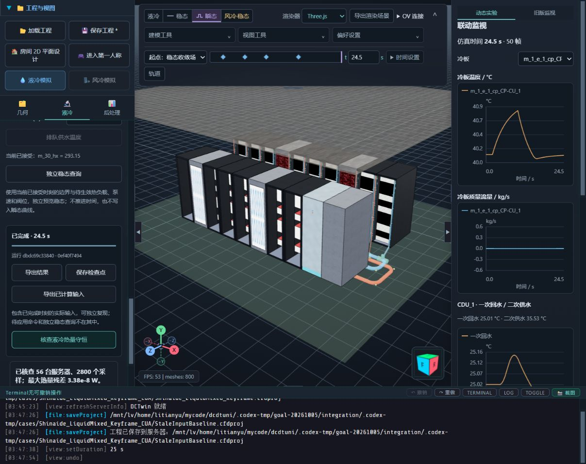

# Shinaide full mixed-keyframe liquid product proof — 2026-10-06

The normal Windows Codex in-app browser connected to the isolated40901 React service8396. ROOT created and saved the actual32-model project, prepared the full graph and completed50 samples at dt0.5s, t=0–24.5s. This is synthetic engineering data. Original product run `b69f923f8c76499eb4ec60c64ae46cb4` completed/converged;1128 unknowns,187nodes/242edges/56coldplates/455watercells/513thermalstates were retained.

The selected CP has heat keyframes100→120(step2.5s)→90(step10.5s)→100(1.5s ramp16.5s). CDU primary inlet20°C→21°C(2s ramp6.5s)→19.5°C(3s ramp10.5s)→20°C(1.5s ramp16.5s). An actual normal120% online heat command entered pending at t5.0s and was accepted at seq11/t5.5s. All14 recorded physical history fields for the preceding11samples remained literally unchanged. An attempted6.25s inlet keyframe was visibly refused as off the0.5s liquid solver grid; no session was produced for that invalid input. These observations do not assert arbitrary controls or waveform coverage.

## Results and independent checks

- Actual heat audit:56servers×50samples=2800; maximum individual coldplate heat closure3.38e-8W. This is distinct from complete graph balance or CFD residual.
- Independent balance assembly plus backward-Euler linear solve agrees with all513 product thermal states over all50 actual samples within5.2484e-10K; node mixing3.9374e-9K. No production residual/advance/JVP is used by this oracle.
- Continuous matrix-exponential reference uses each actual accepted input held over its original0.5s interval. Maximum temporal error is0.114331K. Independent BE subdivision1/2/4/8 gives0.114331/0.058436/0.029548/0.014859K, orders0.9683/0.9838/0.9918. This is method refinement at unchanged accepted forcing, not a new product dt refinement run or a continuously interpolated ramp reference.
- V3 local first-order full-waveform AD/FD runs five complete50-frame trajectories. Heat→final mean solid AD3.3616446284439934, FD3.3616446282280776, relative6.4229e-11. Inlet→final mean primary return AD−0.017951788192975875, FD−0.017951788038317318, relative8.6152e-9. Independent differentiated energy balances reproduce these derivatives to roundoff. Nominal flow and all dynamic temperatures are literally equal to the actual browser baseline for all50 frames. Pressure/node algebraic rows were not included in that added equality gate.
- V2 is preserved as FAIL: inlet→final mean solid is effectively insensitive over this short horizon and fails the declared nonzero guard. Downstream residence is much longer than24.5s; the new primary-return objective was separately declared and physically justified. No threshold was loosened and the original red result is unchanged.
- V2/V3 exited naturally in132.041/159.033s; no timeout or fuser signal occurred. V3's25 stdlib identity/input guards pass. Actual timeout signaling was not exercised. Differentiability here covers thermal waveform amplitudes at fixed topology, hydraulics, properties, initial state and event timing; not UI/JSON, event times, global/second-order or flow-switch derivatives.

## Browser regression found and repaired

The original screenshot contains a false stale-input banner caused by automatic playback changing a generic render revision. The fix separates the engineering-input revision from playback/log/save revisions. Normal UI at run2d4cdf60822d verified playback→24.5s and Save do not stale inputs, while duration24.5→25s does. Fresh run `dbdc69c33840479bbd761ee79c96af78` then completed50frames with automatic playhead24.5 and no stale banner; this separate run has no online commands. Its six actual artifacts are in `actual/stale-fixed-browser-rerun`.

The JPEG is native unedited CUA capture,162050bytes, SHA `f496eac565c0f87262314535e133481a866234eb60b07387efc4921b76d5aa01`. It was transferred by normal React Save into a separate proof-only cfdproj, decoded and rehashed; that proof-only project was never physically executed. Five DOM observations are in `actual/browser-fixed/dom.json`. Original red screenshots remain in `actual/browser`. Browser download-byte capture was not used as proof; backend producer artifacts and actual saved project are bound by SHA instead.

## Reproduction and scope

`actual/project/Shinaide_LiquidMixed_Keyframe.cfdproj` is the actual saved source. `actual/completed` contains original full run artifacts; before/after-online directories bind the history comparison. `actual/root-independent-oracle` contains independent sources/results and the initial interface-error attempt. `trajectory-ad-v2` and `trajectory-ad-v3` retain source, plans, guards, full results, owned worker logs and exit receipts. Tool plans/README describe their pre-execution state; this final overview reports execution. `actual/independent-trajectory-review-20261006` contains separately frozen source and numerical review. Publication manifest binds copied bytes.

Source for the UI fixes was committed in integration84125184 and mainca3f3696. MAIN production build passed and runtime was preserved; the current live MAIN OV tab was not reloaded into the new bundle. Actual fixed-UI acceptance was on the same-source isolated React build. Large Shinaide air mesh remains P13 Failed2/D831/W82; no large air steady/transient acceptance or worktree cleanup is implied. Earlier complete MMS derivation and its distinct manufactured-input evidence remain in `docs/archive/liquid-2026-09-10/shinaide_liquid_full_graph_verification_2026-10-05.md`.
