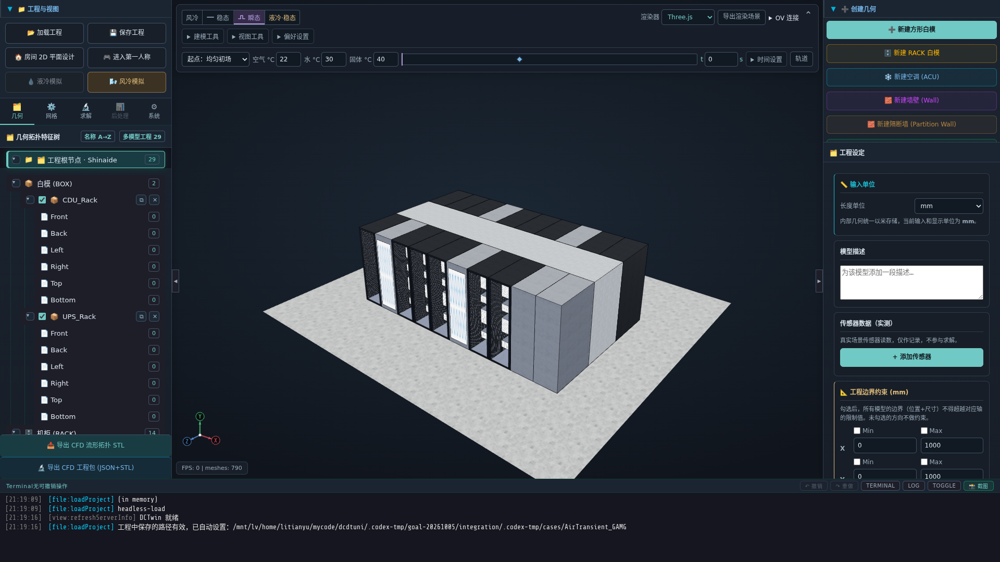
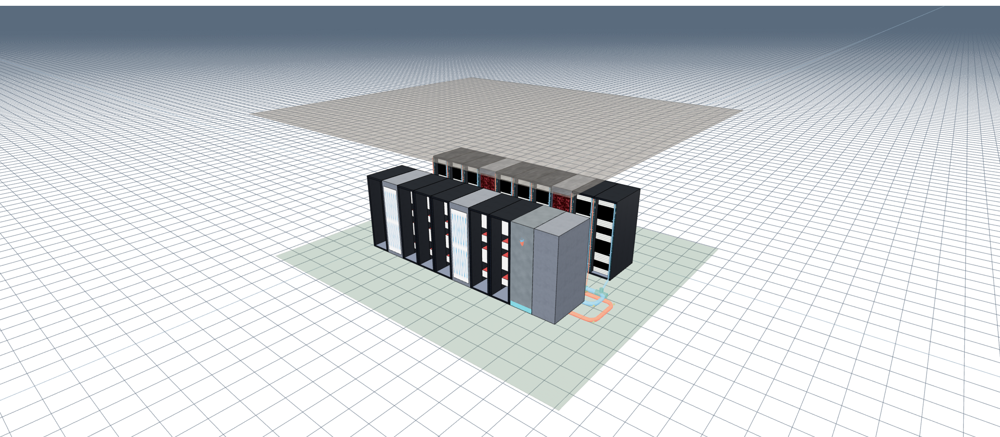

# React usability and aligned layout — actual browser receipt

The current React changes align project bounds, pressure controls and compact presets, preserve numeric values and optional pressure defaults, and make rejected full mesh quality explicit. This directory separates observed UI behavior from solver acceptance. The old mesh remains rejected.

The real in-app Chromium tab at 1280 × 720 accepted valid pressure drafts, rejected illegal values, cancelled a draft on Escape and saved a GAMG-only override. Reload preserved that override. Clearing the optional controls removed the override block. The saved three projects and recursive semantic diff preserve the original floor outlines while moving the legacy polygon key to its supported location.

Pointer-lock failure previously produced an unhandled WrongDocumentError. The final view falls back to drag look and WASD, uses the same Three instance for the BVH, and gives the first-person camera control over yaw. A real mouse drag changed the rack pose; exit restored the normal view. No new browser errors were observed after 20:54 UTC. Historical errors are retained rather than erased.

At 21:17 UTC an actual Solve action hit the strict quality gate before SIMPLE. Native checkMesh exited zero but reported four failed checks. The product returned one, bound the rejected receipt to the actual input and mesh hashes, displayed all five human-readable findings and retained the negative status. During the running job, the controls were inert and Abort remained active. A second Solve click opened only the repair dialog, without launching another native job.

The 1920 × 1080 image below was captured by the actual product software Chromium after loading the saved project. The separate in-app check at 1280 verified all six bounds inputs, their values and alignment. The FPS-zero indicator in the image reflects the idle render loop and is not a solver or geometry acceptance signal.

The full frontend run passed 3269 tests with one skip before the later small view/bounds/quality-feed changes. Relevant subsequent focused Python/React checks and production builds passed; raw outputs are retained. The large-bundle warning remains. This directory makes no large-case checkMesh, SIMPLE convergence, transient accuracy or final-source OV claim.

A fresh actual React DAE experiment after the playhead/loading/checkbox fixes completed 600 seconds with 61 frames (be1cbecb260341e0b199b02a24e28bbd). Its input, executed input, result and checkpoint are preserved under final-source-liquid/; the physical input differs from the prior fair input only in its source-project hash. This is a repeat product/UI check, not a new numerical accuracy claim.

The Prepare action immediately displayed “准备中…” with aria-busy and a disabled button, then returned to ready. This separate preparation-only run (e9a79ec088374aaba1055e5c57141d97) was cancelled at zero seconds and must not be counted as transient completion. During the UI check it revealed that initial numerical convergence had been labelled like a completed steady result; that follow-up status repair is now verified below.

The result selector now always offers its unqualified “最新结果” endpoint explicitly. Picking the completed historical record updated both the result time and timeline to600 seconds, with61 actual samples. The selector grew from84.10 to211.05 pixels at1280×720 by moving its label above the input and leaving the refresh button beside it. The full path is available as a tooltip. The checkbox measured13 pixels and retained normal keyboard focus. Forty related React tests and the production build passed; the raw outputs and copied read-only browser observations are retained. The large-bundle warning remains.

The lifecycle repair preserves numerical convergence separately from experiment completion. A new actual React preparation/cancel action produced run-0008bce5c1b947bdbe582e4b34a98b90 with status=cancelled, completed=false, analysis.mode=transient, expected_duration_s=600 and exactly one accepted initial frame at zero. The view displays “已取消 · 瞬态未完成” and “初态数值求解已收敛”. Selecting the 600-second completed record and then this latest result now resets both result time and playback clock to zero. The previously failing one-frame playback regression is preserved with its failing output.

The historical selection failure was exercised through the actual browser by temporarily renaming the idle owned completed-run directory. The selector stayed on its prior “最新结果” value, the cancelled zero-second result remained visible, and an explicit failure alert appeared. All six original files were restored with identical hashes; selecting the restored record then displayed the completed 600-second result and cleared the alert. This is an observed failed fetch; no independent HTTP status capture was used.

After the lifecycle change the full frontend suite passed 3285 tests with one skip in 69.44 seconds and the production build passed. The subsequent failed-fetch/one-frame clock changes passed 36 related React tests and another production build. These scopes are distinct: the earlier full suite is not presented as a full run of the later source. All raw logs, initial cancellation artifacts, directory preservation hashes and read-only DOM observations are under lifecycle-and-selection/. The old large mesh remains rejected and the final-source OV gate remains pending.

The normal product camera action also saved the current Three viewport (2240 × 980 pixels) below. It contains the 3D canvas only and is not a screenshot of the aligned controls or a new thermal accuracy proof; the actual in-app full-window layout was separately inspected at 1280 × 720.

The current source was then installed and built in the actual main checkout. Its complete frontend suite passed 3292 tests with one skip (336 files passed, one skipped) in 172.75 seconds. This includes the later failed-fetch and one-frame playback changes; the raw main log is retained in lifecycle-and-selection/.

The actual main-checkout fresh run and later themed-popup browser verification are preserved in main-live-primary/. This separately binds the new 600-second CPU result to its raw input/result/checkpoint and the checked main Python source scope. The latest popup uses aligned themed fields without horizontal page overflow at 1280x720. Live OV remains a separate pending gate. The earlier intentional offline signaling error is retained and is not reported as zero console errors.
