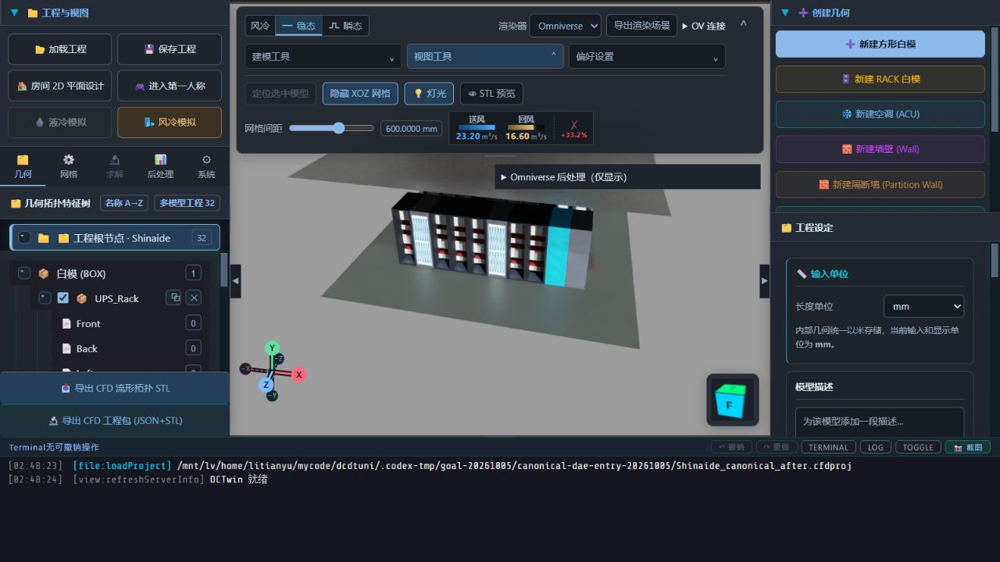
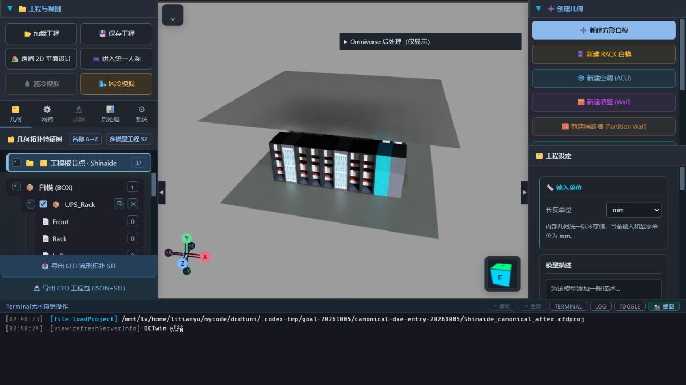

# Main production UI acceptance

Both normal MAIN production builds completed successfully and the final actual served asset was index-_kTgmOFw.js (a6b17290d251b054a4c42732862736db242e0f08357cbf0c9820257fada43926). ROOT and an independent reviewer checked all build payloads and11 source files, package, protected case files, four MAIN process identities and listener assignments.

ROOT loaded the real32-model Shinaide project and selected Omniverse through React. Decoded video was1600×900/readyState4/not paused. All three toolbar disclosure buttons had equal width201.1999969px and height32px, with shared y55.8px. Every selected panel had width615.6000366px and shared x313.2/y95.8px, with mutually exclusive visibility. Full collapse retained a56px cube and92px XYZ gizmo. The renderer select remained connected inside its hidden toolbar slot, with zero exact mode selects outside that slot. A small actual cube drag changed both OV camera and orientation widgets.

The broad .renderer-controls select counter includes three OV postprocessing selectors; that broad count is not a detached renderer-switch failure. The exact aria-label selector is the acceptance check.

Browser screenshots are native CUA JPEG captures. Their SHA was computed in CUA before transfer, then independently matched after normal UI Save into a dedicated throwaway project description and base64 decode. No screenshot rendering, resizing or compositing occurred; the original canonical project stayed byte-identical. This transfer project is never a physical experiment.

