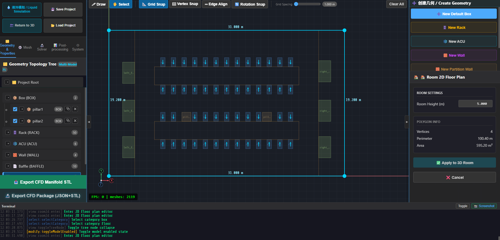
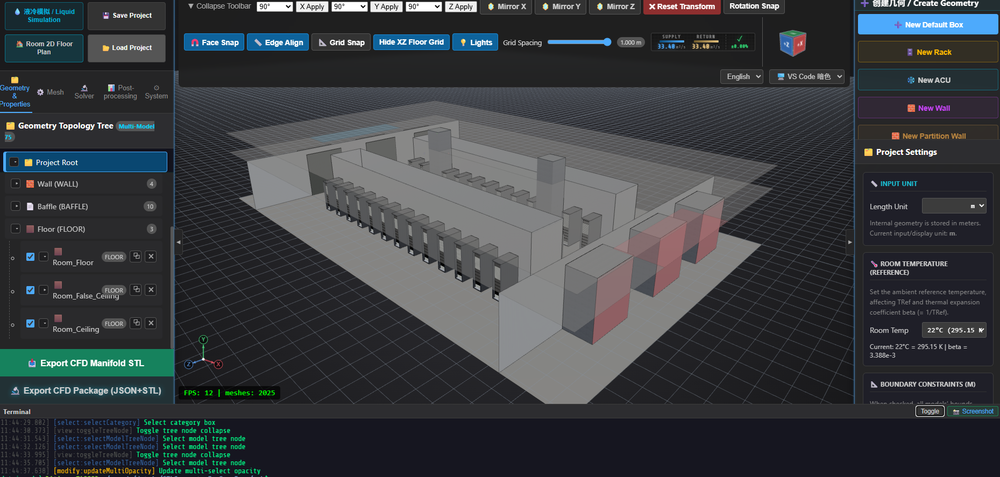
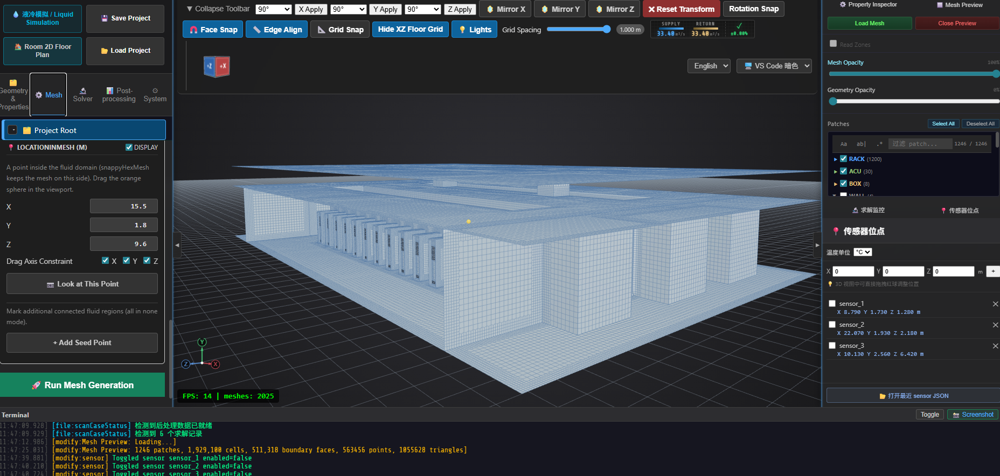
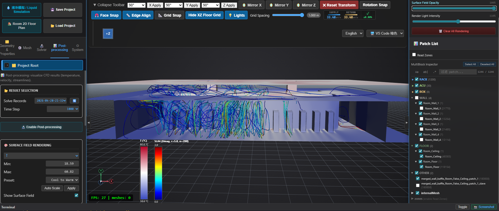
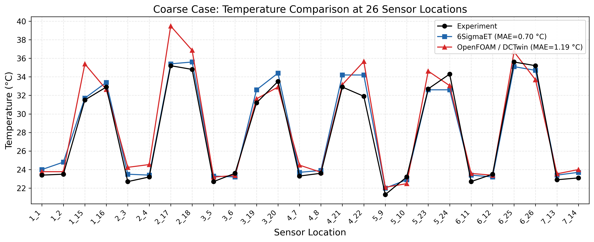
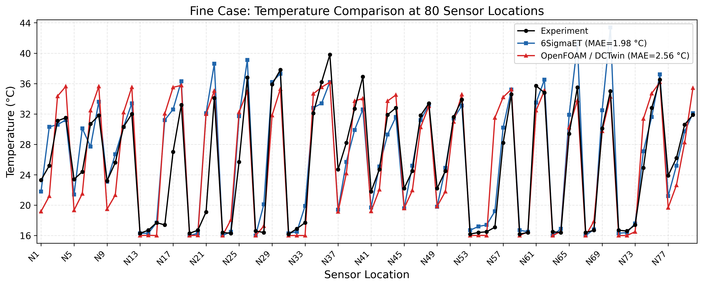
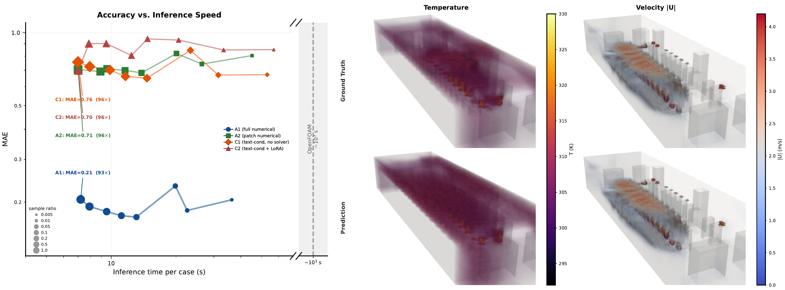
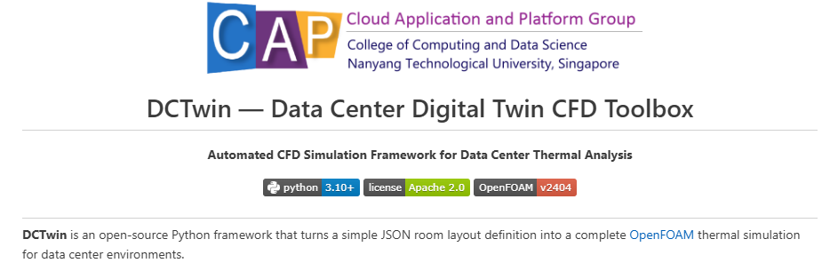

# DCTwin：当数据中心 CFD 仿真遇上 AI Agent —— 一款开源的一站式热仿真工具

---

## 数据中心热管理：一个被低估的工程挑战

数据中心消耗了全球约 1-3% 的电力，而其中相当一部分用于冷却系统。随着 AI 大模型训练对算力需求的爆发式增长，单机柜功率密度从传统的 5-10 kW 攀升至 30 kW 甚至更高，热管理正成为数据中心设计的核心瓶颈。

**计算流体动力学（CFD）仿真**是优化数据中心气流组织和散热方案的黄金标准——通过数值模拟，工程师可以在施工前预测每个机柜、每排服务器的温度分布，从而优化空调布局、避免局部热点。

然而，现实中数据中心 CFD 仿真面临三大痛点：

- **商业软件难以融入 AI 工作流**：6SigmaET、Ansys Icepak 等工具的建模流程锁定在专有 GUI 中，工程文件格式闭源难以编程，也难以融入 AI Agent 驱动的自动化仿真的时代
- **开源方案门槛陡峭**：类似OpenFOAM这样的软件功能强大但配置复杂，从几何建模到网格划分需要大量手工操作和多个独立工具，CAD 建模、网格生成、求解设置、后处理分散在不同软件中，来回切换效率低下
- **仿真反馈周期过长**：传统 CFD 求解一个中等规模数据中心算例需要数十分钟到数小时，无法支撑设计阶段的快速迭代；而现有工具也没有集成 AI 推理的机制，无法实现秒级"拖拽即仿真"的交互体验

**我们希望改变这一现状。**

---

## DCTwin：让开源CFD软件在数据中心场景开箱即用

**DCTwin** 是由新加坡南洋理工大学 Cloud Application and Platform (CAP) 研究组开发并开源的数据中心数字孪生 CFD 仿真框架。它不是 OpenFOAM 的替代品，而是针对数据中心热仿真场景的**垂直工具链**——将"拖拽建模 → 自动网格 → 并行求解 → 3D 后处理"全流程打包进一个操作界面，零 CAD 软件依赖，JSON 配置文件驱动。

下面，让我们沿着一个完整的仿真工作流，看看 DCTwin 能做什么。

---

## 一、2D 平面图：快速规划机房布局

打开 DCTwin 的 Web 界面，首先映入眼帘的是 **2D 俯视平面图模式**。在这里，你可以像画建筑图纸一样快速规划数据中心布局——定义房间尺寸、放置机柜行列、设定 ACU（空调末端）位置、添加隔板和架空地板。

所有操作都在浏览器中完成，所见即所得，布局完成后一键生成 3D 几何模型。

---

## 二、3D 拖拽式几何建模

切换到 3D 视角，你可以对每个组件进行精细编辑：

- **拖拽移动、旋转**：直观地调整机柜和空调的位置
- **对齐吸附**：面吸附、边吸附、网格吸附，确保几何拓扑精确
- **U 槽服务器系统**：机柜内部按照标准 U 高度（44.45mm/U）划分槽位，支持风扇服务器（产生贯穿气流通道）和非风扇设备（封闭壁面）
- **Patch 区域分配**：每个面可独立命名为 OpenFOAM 的边界 patch，用于后续边界条件设置

整个建模过程完全由 `.cfdproj` 工程文件（JSON 格式）驱动——这一设计为后面的 AI Agent 自动化埋下了伏笔。

---

## 三、集成网格生成与预览

几何建模完成后，点击 **"Run Mesh Generation"** 按钮即可一键触发 OpenFOAM 的 blockMesh + snappyHexMesh 网格生成管线。

DCTwin 的特色在于：

- **内置网格预览器**：生成完成后直接在浏览器中检查网格质量，无需打开 ParaView
- **并行网格生成**：支持多核并行加速，大型算例也能快速完成
- **自动 STL 导出**：多区域（multi-solid）ASCII STL 文件自动生成，每个 patch 区域独立命名，确保水密拓扑和外法线方向正确

---

## 四、求解控制与实时监控

求解阶段，DCTwin 提供了完整的控制和监控能力：

- **fvSchemes / fvSolution 控制面板**：在浏览器中直接调整离散格式和求解器参数
- **实时残差曲线**：求解过程中实时显示各变量的残差收敛情况
- **传感器温度监控**：在指定位置放置虚拟传感器，实时追踪温度值
- **中断与重启**：随时暂停、恢复或终止求解任务

底层调用 OpenFOAM 的 `buoyantBoussinesqSimpleFoam` 求解器，支持 MPI 并行计算。

---

## 五、集成后处理

求解完成后，无需导出数据到外部工具——直接在浏览器中进行后处理：

- **温度 / 速度云图**：彩色渲染，支持自定义 colorbar 范围
- **流线可视化**：直观展示气流走向和涡旋结构
- **切片视图**：沿任意平面截取剖面
- **Patch 级别着色**：按边界面独立着色，快速定位问题区域

---

## 精度验证：与商业软件的正面对比

**一个开源工具的精度够用吗？** 我们用两组实验数据给出答案。

### 验证一：26 传感器点 Coarse Case

在一个包含 7 组机柜的中等规模数据中心算例中，我们将 DCTwin（OpenFOAM）与商业软件 6SigmaET 的仿真结果同实验测量值进行了逐点对比：

- **6SigmaET** 平均绝对误差（MAE）：**0.70 °C**
- **OpenFOAM / DCTwin** 平均绝对误差（MAE）：**1.19 °C**

### 验证二：80 传感器点 Fine Case

在一个更大规模的算例中（80 个传感器点，覆盖冷热通道多个高度），进一步验证精度：

- **6SigmaET** MAE：**1.98 °C**
- **OpenFOAM / DCTwin** MAE：**2.56 °C**

**结论**：DCTwin 的仿真精度与商业软件 6SigmaET 处于同一量级。考虑到 OpenFOAM 是完全开源免费的，这一精度水平对于工程设计决策已经足够可靠。

---

## AI 赋能：不只是仿真工具，更是智能平台

除了传统的 CFD 仿真能力，DCTwin 还在积极探索 AI 与仿真的深度融合。以下两项特性展示了这一平台的未来潜力。

### 🤖 AI Agent 驱动的自动建模

DCTwin 的一个关键设计决策是：**前端所有建模操作完全由 `.cfdproj` 配置文件（JSON schema）驱动**。这意味着：

- 每一个机柜的位置、尺寸、服务器配置
- 每一台 ACU 的送风温度、流量
- 房间的几何参数和边界条件

全部以结构化的 JSON 字段定义，有明确的 schema 规范。

这为 **AI Agent 自动化**打开了大门：Agent 只需理解工程文件的 schema 定义，就能通过"创建/编辑 `.cfdproj` 文件 → Browser-use 工具验证 → 反馈修正"的闭环，自动生成数据中心仿真算例。

这套 Agent-ready 架构支持两大应用场景：

1. **参数化扫描（Dataset Curation）**：Agent 批量修改配置参数，自动生成数百个不同工况的仿真算例，用于训练 AI 代理模型或优化设计空间探索
2. **Vibe DC Building（对话式建模）**：用自然语言描述机房需求（如"一个 200 平米的房间，4 排机柜，每排 10 个，2 台精密空调"），Agent 自动生成对应的几何布局和仿真配置

这一能力的学术基础来自我们课题组此前的两项研究工作：

- **ChatTwin** [Li et al., BuildSys '23]：首次提出利用 GPT-4 的 Segment-and-Generate (SG) 工作流，将自然语言描述自动转化为数据中心数字孪生的 JSON 场景文件，生成准确率相比基线提升 55%。([DOI: 10.1145/3600100.3623719](https://doi.org/10.1145/3600100.3623719))
- **ChatDC** [Li et al., ACM Trans. Internet of Things, 2026]：扩展版本，引入 DCBuild 领域代码库和 SGO (Segment-Generate-Optimize) 工作流，在从零生成任务上达到 **98% 成功率**，平均 makespan 缩减 **10×**，并通过 CFD 仿真验证了生成结果的物理合理性。([DOI: 10.1145/3772078](https://doi.org/10.1145/3772078))

DCTwin 的 `.cfdproj` JSON 驱动架构正是这两项工作的工程化落地——从"LLM 生成配置文件"到"Agent 端到端驱动仿真全流程"的自然演进。

### ⚡ Drag-and-Sim：从批量数据生成到AI 推理

训练高精度的 CFD 代理模型，首先需要**大量多样化的仿真数据集**。这恰恰是 DCTwin 的独特优势——得益于 JSON 驱动的全流程自动化管线和上述 Agent-ready 架构，DCTwin 可以轻松实现：

- **批量参数化生成**：通过脚本或 AI Agent 自动修改 `.cfdproj` 中的机柜布局、功率密度、空调参数等，一键生成数百个不同工况的仿真算例
- **全自动 CFD 求解**：从 STL 几何导出、网格生成到并行求解，无需人工干预，适合大规模数据集构建
- **结构化输出**：每个算例的网格、边界条件和场数据以标准 OpenFOAM 格式存储，可直接用于 AI 模型训练

基于 DCTwin 生成的 **700 个数据中心热仿真算例**，我们训练了**FVGN（Finite Volume Graph Network）** 图神经网络代理模型，实现了"拖拽即仿真"的交互体验——用户调整布局后，AI 模型在**秒级**返回温度场和速度场预测，无需等待 OpenFOAM 数十分钟的迭代求解。

下图展示了 AI 代理模型的**精度-速度权衡**（左）和**3D 场预测效果**（右）。A1 方案在默认采样率下实现 **34× 加速**，MAE 低至 **0.21**；C1（文本条件编码）方案完全绕过 CFD 求解器，适用于延迟敏感的 what-if 分析：

---

## 开源地址

DCTwin 已在 GitHub 上以 **Apache 2.0** 协议开源：

**🔗 仓库地址**：[https://github.com/CAP-GDCR/Dctwin-CFD](https://github.com/CAP-GDCR/Dctwin-CFD)

**技术栈**：

- Python 3.10+ / OpenFOAM v2404
- Apache 2.0 开源协议

---

## 写在最后

DCTwin 诞生于我们对"让数据中心 CFD 仿真更易用"这一目标的持续追求。从最初的命令行脚本，到如今集建模、网格、求解、后处理于一体的 Web 平台，再到 AI Agent 和 Drag-and-Sim 的前沿探索，我们相信开源协作是推动这一领域进步的最好方式。

如果你是数据中心工程师、CFD 研究者，或者对 AI+仿真的交叉方向感兴趣，欢迎：

- ⭐ **Star** 我们的仓库，关注后续更新
- 🍴 **Fork** 并提交你的改进
- 📝 提 **Issue** 告诉我们你的需求和建议

**让我们一起，让数据中心热管理变得更智能、更开放。**

---

*本项目由新加坡南洋理工大学 Cloud Application and Platform (CAP) 研究组开发维护。*
