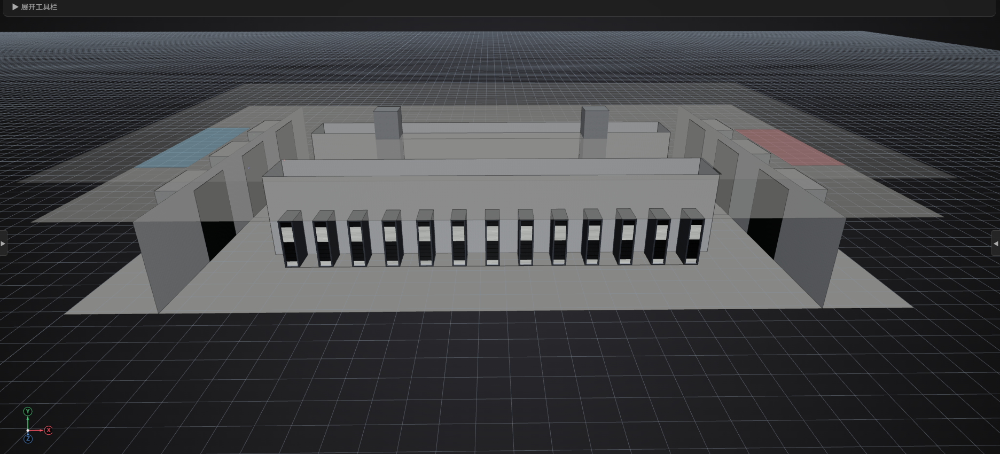
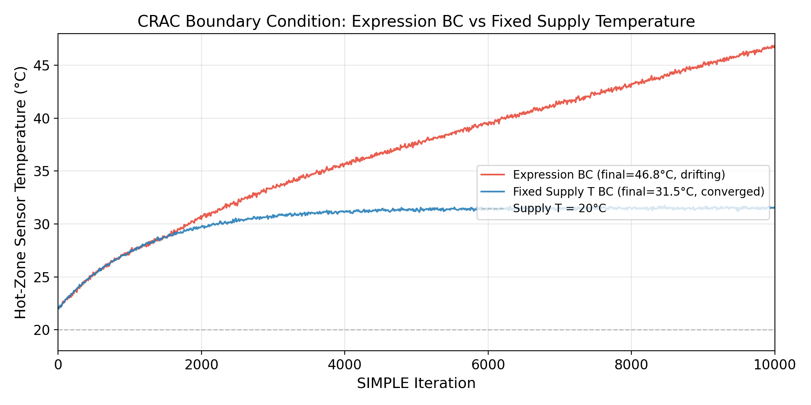
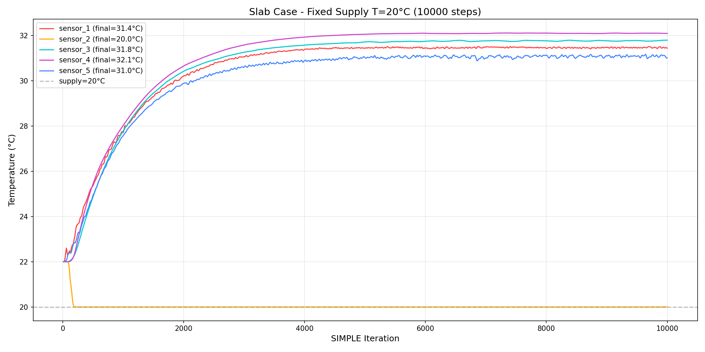
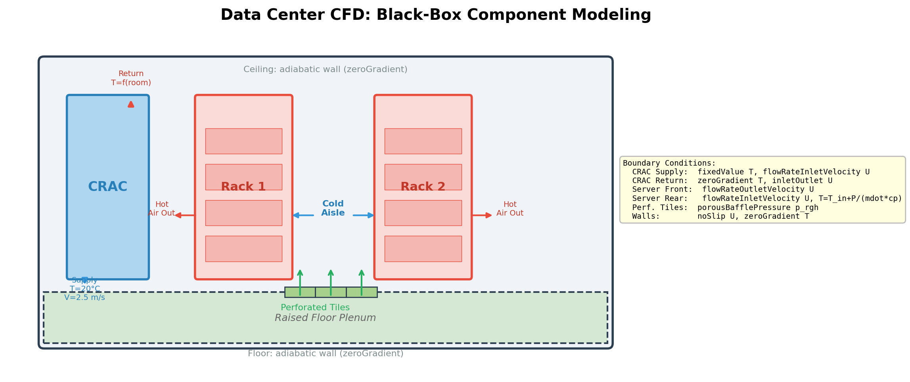
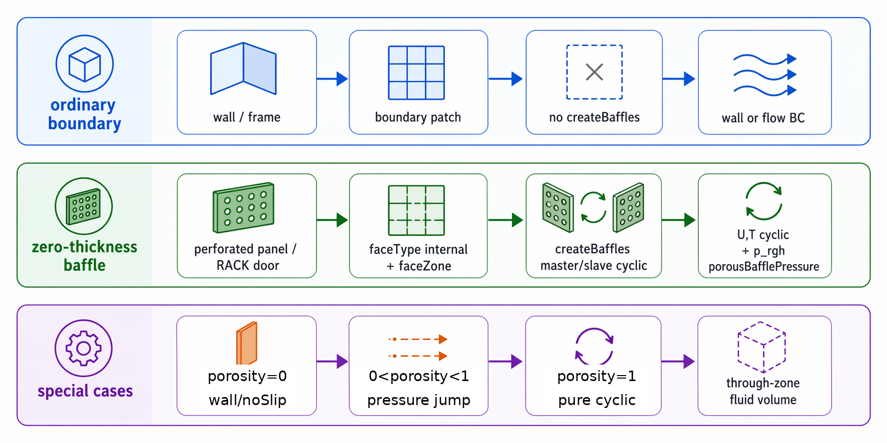
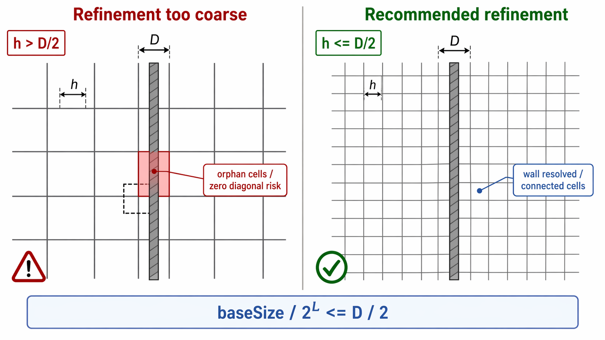
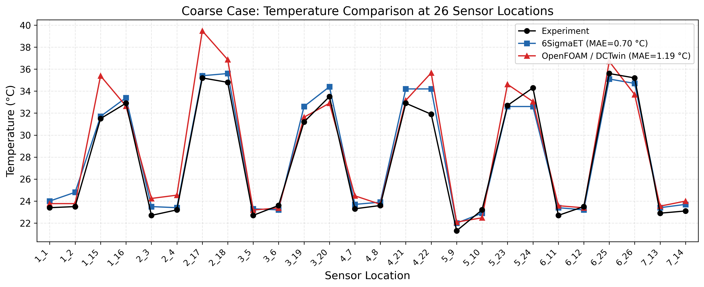
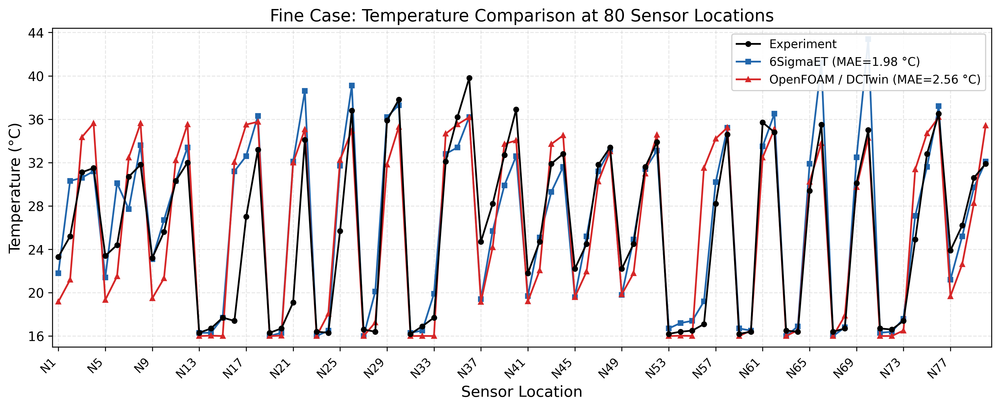

# 数据中心CFD仿真中的黑箱建模：边界条件、自动网格与收敛判据

**基于DCTwin的工程实践**

---

<span style="color:blue">近日，南洋理工大学CAP团队在GitHub上开源了数据中心CFD仿真工具DCTwin（https://github.com/CAP-GDCR/Dctwin-CFD ）。DCTwin是一个基于OpenFOAM的自动化CFD框架，接收JSON格式的仿真配置文件（.cfdrun）与预导出的多区域STL几何文件，自动完成从blockMesh、snappyHexMesh网格生成到边界条件配置与求解的完整流程。本文基于DCTwin的开发实践，分享我们在边界条件设置、自动网格加密和收敛判据方面遇到的具体问题与解决方案。</span>

## 1. 引言

数据中心的热管理问题正在变得越来越工程化和系统化。机柜功率密度提升、冷热通道组织、架空地板送风、空调回风路径和局部热点之间相互耦合，使得单靠经验规则很难判断一个布局是否可靠。CFD仿真能够在设计阶段给出温度、速度和压力场的空间分布，但真正落地时，工程师还要面对几何建模、网格划分、边界条件、求解控制和后处理等一整套工具链问题。在这个背景下我们开发了DCTwin数据中心热仿真数字孪生工具。以OpenFOAM为底层CFD求解器，而是面向数据中心场景，把几何建模、仿真配置、STL导出、OpenFOAM网格/求解以及浏览器端后处理串成一条相对完整的自动化流程。一方面降低OpenFOAM在数据中心CFD场景中的使用门槛，另一方面也是为了让仿真过程更容易被脚本、批量工况和未来的AI Agent工作流调用。

在这个过程中，我们逐渐发现，数据中心CFD热仿真的核心挑战并不只是“把模型建完跑起来”。服务器和空调（CRAC/ACU）等核心设备通常不解析其内部流场，而是作为"黑箱"进行建模：服务器被简化为一个穿流通道——冷空气从前面板进入，经过芯片散热后从背板排出热空气；空调则被简化为一个冷源——回风口吸入热空气，送风口排出冷空气。这种黑箱建模方式是数据中心CFD中的常见做法[1]，但边界条件、网格分辨率和收敛判据的细节会显著影响结果的可信度。

因此，本文的目的是分享我们在开发过程中遇到的一些具体问题和对应解决办法。其中，边界条件看似只是输入参数的选择问题，实际上牵涉到求解器的收敛特性；网格加密看似只是精度设置，实际上会影响薄壁结构和零厚度baffle能否被稳定解析；残差收敛看似给出了停止标准，实际上不一定代表温度场已经达到物理稳态。下面我们围绕这几类问题展开，希望这些经验对从事数据中心CFD仿真的工程师和研究者有所帮助。图1展示了本文讨论对象对应的三维机房几何模型。



*图1：DCTwin三维建模界面，展示数据中心机房的几何模型构建*

---

## 2. CRAC热边界条件

在我们的调试经验里，空调边界常常比预期更容易被低估。几何模型看起来正确、风量和功率也填得完整，但只要送风温度的边界条件与求解器迭代方式不匹配，温度场就可能表现出持续漂移或难以稳定的问题。我们在DCTwin调试中遇到的一个典型教训，正是CRAC热边界条件并不是“把公式写进去”那么简单，而是要同时考虑物理含义和数值收敛性。

### 2.1 四种CRAC边界条件方法

CoolSim白皮书WP105[2]系统总结了数据中心CFD中CRAC的四种热边界条件设置方法。第一种是**固定送风温度（Supply Temperature）**，直接将送风口温度指定为常数值，例如20°C。这是最简单也最常用的方式，适用于送风温度由空调控制器调节并在设定值附近波动的场景。具体控制精度取决于设备、控制策略和运行工况；在稳态CFD中，将送风温度建模为常数通常是一个可控的工程近似。

第二种是**温降法（Temperature Drop）**，指定回风与送风的温差 ΔT = T_return - T_supply，送风温度随回风温度动态变化。这种方式隐含了一个假设：空调的制冷能力足以维持恒定的温降，无论热负荷如何变化。在设计工况下这一假设成立，但在过载或部分负荷工况下可能偏离实际。

第三种是**制冷量法（Cooling Capacity）**，指定空调的制冷量Q，根据能量守恒公式 Q = ṁ·cp·(T_return - T_supply) 反算送风温度。这种方法能够表达空调制冷能力的上限——当热负荷超过额定制冷量时，Q被截断为Q_max，送风温度相应升高，通常比固定温降更接近过载工况下的物理行为。第四种是**性能曲线法（Performance Data）**，使用空调厂商提供的多维性能曲线，制冷量随回风温度、湿度等参数变化，能更贴近具体设备特性，但实现和数据准备也最复杂。

在实际应用中，固定送风温度是稳态仿真中常见的选择[1]。这不仅是因为实现简单，也因为在稳态SIMPLE求解框架下，一个明确的送风温度Dirichlet边界通常更有利于获得稳定的温度场。下面我们将解释为什么带反馈的制冷量表达式在稳态求解中可能遇到麻烦。

### 2.2 Expression BC在稳态SIMPLE中的陷阱

一个自然的想法是在稳态仿真中使用制冷量法，即通过OpenFOAM的expression BC让送风温度根据回风温度动态计算：

```
T_supply = max(T_return - Q_actual / (ṁ · cp), T_min)
```

其中 Q_actual = min(Q_needed, Q_max)，Q_needed = ṁ·cp·(T_return - T_setpoint)。这个公式的物理含义是清晰的：空调根据回风温度计算所需制冷量，如果所需制冷量超过额定值则截断，同时送风温度不低于下限T_min。从模型形式看，它更适合描述随时间响应的空调控制；但如果直接放入稳态SIMPLE迭代中，可能引入不利于收敛的反馈。

问题的根源在于反馈增益。当热负荷超过空调制冷能力、Q_actual被截断为Q_max常数后，上式简化为：

```
T_supply = T_return - Q_max / (ṁ · cp) = T_return - const
```

此时 dT_supply/dT_return = 1，即增益为1。这意味着回风温度每上升1°C，送风温度也上升1°C，温度场中可能出现一个"中性模态"（neutral mode）——温度的绝对值缺少足够强的锚定，只有温差被约束。SIMPLE迭代的亚松弛机制不一定能抑制这种模态，表现出来就是温度场缓慢漂移。需要注意的是，当温度下降到触发下限保护（T_min clamp）时，增益变为0，此时漂移会暂停；但在T_min未生效的工况下，温度场可能难以收敛到稳定解。

在我们的调试过程中，曾观察到与上述机制一致的现象：使用expression BC的稳态求解中，热区传感器温度在初始阶段正常上升，但随后不再趋于稳定，而是继续缓慢漂移；使用固定送风温度BC的相同案例，则在数千步后进入稳定平台。图2根据调试记录和固定送风温度参考结果整理成对比曲线，用于展示这种趋势，而不是新的独立验证实验。



*图2：CRAC边界条件收敛趋势对比（根据调试记录重构）。红色曲线：使用expression BC（制冷量模式）时温度持续漂移；蓝色曲线：使用固定送风温度BC时温度在数千步后进入稳定平台*

### 2.3 不同求解模式下的边界条件策略

理解了增益为1的本质原因后，针对不同求解模式可以采用更稳妥的边界条件策略。对于**稳态求解（BUOYANTBOUSSINESQSIMPLE求解器）**，优先使用 `fixedValue` 边界条件，直接将送风温度设为空调设定点温度。这提供了一个确定的Dirichlet锚点，有助于固定温度场的绝对水平，降低稳态漂移风险。从物理角度看，这等价于假设空调控制器在稳态意义上维持设定温度；对于许多稳态容量分析和热点识别任务，这是一个常见且可控的简化。

对于**瞬态求解（PIMPLE）**，expression BC在数值结构上更合适。瞬态求解的外层时间步进提供了自然的时间锚定——每个时间步的初始场来自上一步的结果，PIMPLE内迭代主要在这个初始场附近求解增量修正，因而更适合表达制冷量随回风温度变化的动态响应。不过在DCTwin当前实现中，瞬态/PIMPLE路径仍属于实验性功能，求解字典还有进一步完善空间。因此更谨慎的表述是：瞬态框架为动态制冷量耦合提供了更合适的基础，但工程使用前仍应针对具体案例做验证。

对于需要精确模拟空调动态特性的场景，更先进的方法是**联合仿真（co-simulation）**。Lu等人[3]在IBPSA 2023中展示了一种基于FMU（Functional Mock-up Unit）的方法，将OpenFOAM的三维流场求解与一维制冷循环模型耦合。两个求解器在每个时间步交换边界数据：OpenFOAM向制冷模型提供回风温度和流量，制冷模型向OpenFOAM返回送风温度和送风量。这种方式能够捕捉空调的开停机、变频调节等瞬态行为，代价是系统集成的复杂度显著增加。

以下是稳态仿真中固定送风温度的OpenFOAM边界条件设置示例：

```
ACU_Back_patch
{
    type            fixedValue;
    value           uniform 293.15;  // 20°C set point
}
```

### 2.4 DCTwin的实现

DCTwin通过读取求解器类型来选择边界条件，尽量把这类数值细节从普通用户侧隐藏起来。当前端配置中选择稳态求解时，无论用户是否同时配置了制冷量参数，系统都使用 `fixedValue` BC，以空调设定点温度作为送风温度；只有在用户明确选择瞬态求解时，代码路径才会启用expression BC，将制冷量、回风温度、最低送风温度等参数编码为OpenFOAM的expression字段，实现动态温度耦合。核心逻辑如下：

```python
solver_type = simulation_config.get("solverType", "steady")
use_expression = (cooling_capacity and return_patch
                  and solver_type == "transient")
if use_expression:
    # transient: expression BC, T_supply = f(T_return, Q)
else:
    # steady: fixedValue at set point temperature
```

这一设计遵守"保守默认"的原则——在SIMPLE求解特性的情况下，系统优先选择更不容易触发温度漂移的边界条件。如果要在稳态分析中考虑制冷量限制的影响，更稳妥的做法是先用fixedValue BC完成基准仿真，再通过改变送风温度或运行经过验证的瞬态/联合仿真方案来观察温度场变化，而不是在稳态SIMPLE中直接依赖expression BC的自动反馈。



*图3：DCTwin测试案例的传感器温度收敛曲线（固定送风温度20°C，10000步SIMPLE迭代）。热区传感器（sensor_1/3/4/5）在约3000步后进入31-32°C附近的平台区，但个别位置仍可能缓慢漂移；冷区传感器（sensor_2）稳定在20°C*

---

## 3. 服务器机架黑箱建模

解决了冷源边界后，下一步通常是处理机房中最常见也最关键的热源对象：服务器和机柜。这里的难点不在于画出一个机柜外形，而在于判断哪些面代表气流进出，哪些设备只是阻挡体，哪些薄面又应该被看作压降界面。如果这些对象都被简单处理成普通墙面，几何上也许能通过网格生成，但热量、流量和压降的传递关系就会偏离真实机房的工作方式。

### 3.1 风扇服务器

带风扇的服务器是数据中心中最主要的热源，也是黑箱建模中最核心的对象。在CFD仿真中，每台风扇服务器被简化为一个穿流通道（through-flow channel）：冷空气从服务器前面板进入，流经内部的CPU、内存和硬盘等发热组件后，携带热量从背板排出。这一过程通过两个相对的边界面来建模。

从机房流体域的角度看，服务器前面板是空气离开机房、进入服务器黑箱的边界，因此DCTwin使用 `flowRateOutletVelocity`；背板是热空气从服务器进入机房的边界，因此使用 `flowRateInletVelocity`。温度方面，前面板采用 `zeroGradient`，意味着进入服务器的空气温度由其前方的环境流场自然决定。背板温度则按能量守恒构造：T_out = T_in + P / (ṁ · cp)，其中P是服务器功耗，ṁ是质量流量，T_in来自对应进风面的平均温度。例如，一台功耗1kW、风量0.05 m³/s的服务器，若取空气密度约1.2 kg/m³且进风温度为20°C，排风温度约为 20 + 1000/(0.06×1005) ≈ 36.6°C。

这种建模方式假设服务器内部气流混合均匀、排风温度空间均一，忽略了实际服务器内部可能存在的热点分布不均匀现象。但对于数据中心级的宏观仿真——关注的是机房整体温度分布、热通道温度、冷热气流混合等问题，而非单台服务器内部的散热细节——这一简化通常是可接受的工程折中。更精细的服务器内部建模需要对每台服务器单独构建详细的几何和网格，在完整机房仿真中成本很高，且不一定符合当前分析目标。

### 3.2 非风扇设备

机柜中除了风扇服务器外，往往还安装有交换机、配线架、UPS电源等非风扇设备。这类设备与风扇服务器的本质区别在于：它们没有主动穿流风扇，不应被建模为前后贯通的流量通道。因此，在CFD建模中，非风扇设备首先是一个不透流的阻挡体：速度场采用 `noSlip`（无滑移）。热边界则取决于用户给定的热模型：未指定发热的表面可采用 `zeroGradient`；需要表达表面温度时可使用固定温度边界；需要表达总功耗时可将功率折算为表面热通量。DCTwin当前实现支持固定温度和热通量两类非风扇发热面，而不是在所有表面同时设为绝热又额外引入体热源。在采用Boussinesq近似的不可压缩求解框架中，辐射换热通常未显式建模，主要关注对流传热和设备的阻挡效应。

### 3.3 架空地板与穿孔地砖

数据中心通常采用架空地板下送风系统：CRAC将冷空气送入地板下方的静压箱（plenum），冷空气通过穿孔地砖上升进入机房冷通道，为服务器提供冷源。穿孔地砖是连接静压箱与机房的关键界面，其气流阻力特性对冷量分配有显著影响。

在DCTwin的OpenFOAM管线中，穿孔板采用 `porousBafflePressure` 边界条件配合cyclic面对实现。该边界条件在面对两侧施加一个局部压降，其Darcy-Forchheimer形式为：

```
ΔP = ½ · ρ · (D · μ · U + I · ½ · ρ · U²) · L
```

其中D是粘性阻力系数（Darcy项），I是惯性阻力系数（Forchheimer项），L是归一化长度。对于数据中心穿孔地砖这类薄板结构（板厚远小于孔径），流动损失以局部惯性效应为主，粘性项可忽略（D≈0），阻力主要由惯性项I承担。

关键问题在于如何将用户容易理解的物理参数——孔形（圆形、方形）、开孔率σ（开孔面积占总面积的百分比）——转换为OpenFOAM需要的D和I系数。DCTwin采用Idelchik[6]经典的薄壁穿孔板阻力公式来完成这一转换。该公式将总阻力系数K表示为开孔率σ和孔形系数φ的函数：

```
K = [1 + φ · 0.707 · (1-σ)^0.5 - σ]² / σ²
```

其中φ是孔形修正系数，反映不同孔形在缩流断面（vena contracta）处的损失差异：圆孔φ=1.0（参考值），方孔φ=1.1，菱形孔φ=1.15——非圆形孔的尖角处会产生额外的分离损失。将计算得到的K值直接赋给I系数（D=0, length=1），即可完成从用户参数到OpenFOAM边界条件的映射。例如，开孔率25%的圆孔穿孔板，K ≈ 29.7；开孔率64%的圆孔穿孔板（常见于机柜门板），K ≈ 1.5。

穿孔率的选择直接影响冷通道的送风量分配。靠近CRAC的穿孔地砖由于静压箱内的压力梯度，往往比远端地砖输送更多的冷空气。这种送风不均匀性是数据中心气流管理中的一个经典问题，可以通过选择不同穿孔率的地砖来调节。

从网格生成角度看，穿孔地砖、穿孔面板和RACK door都不应被当作普通 `wall` patch处理。普通壁面patch只保留流体域的一侧，适合实体墙或设备外壳；而穿孔面板本质上是零厚度压降界面，面板两侧都应保留流体网格，并通过一对重合的master/slave面来施加压降。因此DCTwin对这类OBJ/STL走的是独立的baffle管线：在 `snappyHexMeshDict` 中将对应表面写成 `faceType internal` 并创建 `faceZone`，让snappyHexMesh保留该面两侧的体网格；随后由 `createBaffles` 根据faceZone生成 `*_master` / `*_slave` 两个 `cyclic` patch；最后在场文件中对速度和温度保持cyclic耦合，对 `p_rgh` 写入 `porousBafflePressure`。这样，几何仍然是零厚度面，但压力方程会看到由开孔率和孔形计算得到的局部压降。

这一分支还包含两个边界情况：当开孔率σ=0时，穿孔面板退化为不透流挡板，master/slave面会被转成wall语义，速度为noSlip；当σ=1时，面板退化为完全开口，所有主要场采用纯cyclic耦合，不额外施加压降。当前RACK door实现会将所有门板合并为统一的 `merged_rack_door.stl` 和一个faceZone，因此默认按统一开孔率处理；如果未来需要每个门板独立开孔率，就需要把它们拆成独立faceZone或独立createBaffles条目。

### 3.4 DCTwin的U-slot系统

在实际数据中心中，一个42U标准机柜内可能混装十几台不同类型、不同功耗的设备。为每台设备手动配置边界条件不仅繁琐，而且容易出错。DCTwin通过U-slot系统缓解了这一问题。

每个标准机柜被划分为若干44.45mm高度的U位（1U = 1.75英寸），用户在前端界面中为每个U位指定设备类型和参数。系统根据设备类型自动生成对应的边界条件：风扇服务器自动创建穿流通道——前面板和背板生成成对流量BC，排风温度根据设备功耗和风量由系统计算；非风扇设备自动生成不透流壁面，并可在指定发热面附加固定温度或热通量BC；未安装设备的空U位则可保持为开放区域，允许气流穿过机柜。这种基于U位的自动化方式降低了用户的配置工作量，也通过程序化方式提高了物理建模的一致性——例如，系统会自动确保服务器进出风面的面积和位置与U位高度对应，减少人为配置时可能出现的几何不匹配。图4将CRAC、服务器、架空地板和壁面这些黑箱对象放在同一张示意图中，便于对照它们各自的边界条件角色。



*图4：数据中心CFD黑箱建模示意图。展示了CRAC（送风温度+流量BC）、服务器机架（成对流量BC+功耗换热）、架空地板（porousBafflePressure BC）以及壁面（绝热BC）的边界条件设置*

---

## 4. 自动网格加密策略

边界条件定义清楚之后，仿真仍然可能在网格阶段失败。数据中心模型看似由规则的墙、机柜和地板组成，但实际导出的STL/OBJ里会同时包含普通实体面、零厚度穿孔面、薄壁隔断和局部复杂交叉结构；这些对象通常不适合全部交给同一套默认网格参数处理。DCTwin自动网格策略的核心目标之一，是把这些几何差异提前转化为不同的OpenFOAM网格管线和加密规则，尽量减少用户手工调字典的成本。

### 4.1 两阶段网格生成管线

DCTwin采用OpenFOAM中常见的两阶段网格生成方案。第一阶段是**blockMeshDict**，生成覆盖整个计算域的均匀六面体背景网格。基础网格尺寸（如0.2m）作为全局参数设定，决定了背景网格的分辨率上限和网格总量。blockMesh生成的背景网格是一个简单的长方体，完全由顶点坐标和每个方向的单元数定义，不涉及任何复杂几何的处理。

第二阶段是**snappyHexMeshDict**，在背景网格的基础上进行表面贴合和局部加密。snappyHexMesh读取STL格式的几何表面文件，在这些表面附近对背景网格进行自适应细分。每个STL表面可独立设置加密等级（refinement level），等级L意味着该表面附近的背景网格单元被2^L次细分——例如，基础尺寸0.2m在level 3下被细分为0.2/8 = 0.025m。当前DCTwin管线默认关闭边界层添加，重点放在笛卡尔背景网格、表面贴合和关键几何的局部加密上。这种两阶段设计的收益在于，用户只需指定少量参数（基础尺寸和各表面的加密等级），系统就能在全局粗网格的基础上仅在关键区域局部加密，兼顾计算精度和效率。

### 4.2 不同OBJ类型的网格管线

不同OBJ/STL类型不能使用同一条OpenFOAM网格路径。实体墙、服务器外壳和机柜框架应生成普通壁面patch；ACU送回风口和服务器进出风面应生成普通边界patch，再由边界条件注册表写入流量和温度条件；穿孔地板、穿孔面板和RACK door则需要先作为internal face保留两侧网格，再通过createBaffles生成cyclic耦合面；不透流挡板也会先经过createBaffles，但随后转成wall语义。图5概括了这些路径的差异。



*图5：不同OBJ/STL类型的网格生成与边界条件管线。穿孔面板和RACK door采用 `faceType internal + faceZone → createBaffles → cyclic master/slave → porousBafflePressure` 的路径，而普通实体墙和流量边界不会进入createBaffles分支*

### 4.3 blockMeshDict的网格线对齐优化

背景网格的质量虽然常被忽视，但它直接影响snappyHexMesh的后续加密效果。一个关键的观察是：如果blockMesh的网格线恰好与关键几何特征对齐——例如服务器进出风口的边界、机柜的侧壁——snappyHexMesh在这些位置的表面贴合质量会显著提高。原因在于，当STL表面恰好落在网格线上时，snappyHexMesh只需删除表面一侧的单元并保留另一侧，而不需要对单元进行裁剪和变形，由此减少了非正交面和畸变单元的产生。

然而，对于给定的基础网格尺寸baseSize，房间尺寸通常无法被baseSize整除，存在多种分割方案。不同的分割数N会产生略有不同的单元尺寸cell_size = 房间尺寸/N，进而导致网格线在空间中的位置不同。DCTwin实现了一种自动优化算法来选择最优的分割数。对于每个坐标轴，算法首先从所有轴对齐机柜中收集关键几何面的坐标值——包括服务器进风面、出风面的位置以及机柜边缘的坐标。然后以N_target = round(房间尺寸/baseSize)为中心，在±12的范围内遍历所有候选分割数。对每个候选值N，算法计算cell_size = 房间尺寸/N，并累加所有关键坐标到最近网格线的偏差，最终选择总偏差最小的方案。同时，房间边界会落在网格线上，并在每侧额外填充1个单元作为背景缓冲。

这一优化的计算开销很小（每轴仅遍历约25个候选值）。在一个内部测试配置中，服务器进出风面的off-grid偏差指标从未优化时的约44%降至15%以内，机柜边缘面的最大偏差控制在35%以内。这个数字不应理解为普适保证，但说明背景网格线对齐对后续表面贴合有实际帮助。

### 4.4 薄壁问题

数据中心机房中常见的隔断墙（partition wall）是网格生成中的一个典型难题。这些隔断墙的厚度通常只有50-100mm，远小于背景网格尺寸。当snappyHexMesh在这些薄壁结构附近进行表面贴合时，如果局部网格尺寸h_local不够小，就会出现严重的问题：网格单元的尺寸大于墙体厚度的一半，导致有些单元的中心落在墙体内部。这些被"捕获"的孤立单元（orphan cells）缺少有效的内部连接面，可能在温度方程的离散矩阵中产生零对角元素，使求解器在初始迭代阶段出现NaN并崩溃。

推荐的加密等级通常需满足以下条件：

```
baseSize / 2^L ≤ D / 2
```

以基础尺寸0.2m、隔断墙厚度D=0.05m为例：Level 1下h = 0.10m，远大于D/2 = 0.025m，风险较高；Level 2下h = 0.05m，仍大于D/2，风险仍然存在；Level 3下h = 0.025m，恰好等于D/2，达到推荐条件。DCTwin的后端预检（preflight）会在网格生成前扫描隔断墙厚度，并在当前加密等级不足时发出警告和推荐等级；前端界面的"自动检测"按钮使用同一公式将推荐等级写入配置。需要强调的是，后端预检当前主要承担风险提示作用，并不会强制改写用户设置；真正提高加密等级仍依赖前端自动检测或用户手动调整。因此它能显著降低薄壁加密不足的风险，但不能替代最终的checkMesh检查。

```
merged_partition_wall.stl
{
    level (1 1);  // 对于D=0.05m的墙体过于粗糙
    // DCTwin警告: 推荐 level >= 3
}
```

图6以剖面示意的方式对比了加密不足和加密充分时的薄壁解析效果。



*图6：薄壁网格加密等级示意图。左图：加密不足（h > D/2），墙体内部容易捕获孤立网格单元（红色），可能导致求解器发散；右图：加密充分（h ≤ D/2），墙体更容易被网格解析，网格质量更稳定*

### 4.5 多Region诊断

网格生成完成后，运行checkMesh进行质量检查是标准流程。checkMesh可能报告"Number of regions: N"，提示网格包含N个不连通的区域。初次遇到这一信息时，很容易将其误判为网格错误。但需要强调的是，**多Region不等于网格错误**。在采用冷通道封闭（Cold Aisle Containment）或热通道封闭（Hot Aisle Containment）的数据中心中，物理上的封闭结构将机房空间分割为多个独立的流体域——封闭的冷通道内部是一个独立区域，开放的热通道和机房回风空间是另一个区域。如果这些区域是用户预期的封闭流体域，并且具有正确的边界条件和足够单元数量，就应保留；盲目删除反而会破坏仿真的物理正确性。

当前DCTwin自动清理主要针对两类明确的拓扑问题。第一类是**孤立单元（orphan cells）**，checkMesh报告为"cells with zero or one non-boundary face"。这些是snappyHexMesh在STL几何的尖角处或薄壁结构附近产生的碎片单元，它们在拓扑上与主网格相连（point-connected），但没有有效的内部连接面，无法参与正常的流场求解，可能导致矩阵奇异。第二类是**全断开Region**，通常只包含少量单元，是snappyHexMesh在复杂几何交叉处产生的数值伪影。DCTwin的 `_remove_disconnected_cells()` 方法采用两阶段策略处理这两类问题：首先通过checkMesh的region分析识别 `fully disconnected` 的碎片Region并用topoSet标记，只保留 `point connected` 的Region；如果没有全断开Region，再通过 `oneInternalFaceCells` cellSet识别孤立单元并取反集；最后使用 `subsetMesh` 执行清理。这里的自动判断依据是checkMesh的拓扑分类，而不是简单地根据Region数量下结论。

---

## 5. 稳态收敛判据

即使边界条件和网格都没有明显错误，稳态仿真也还有一个容易被忽略的问题：什么时候可以停。OpenFOAM日志里的残差曲线会给人一种明确的判断依据，但数据中心的温度场往往比速度场收敛得更慢；残差下降并不自动意味着用户关心的热点温度已经稳定。因此，DCTwin把收敛判断从“方程是否容易求下去”进一步推进到“关键位置的物理量是否已经不再变化”。

### 5.1 残差收敛是必要但不充分条件

在稳态SIMPLE求解中，残差（residual）是最直观的收敛指标。每一步迭代结束后，求解器报告各方程（连续性、动量、能量、湍流）的残差值，反映该步迭代的方程离散误差。通常的做法是设定一个残差阈值（如10^-4），当所有方程的残差降至该阈值以下时，认为计算已收敛。

然而，**残差收敛不等于物理收敛**。残差衡量的是当前步迭代修正量的大小，而非物理量场是否已达到最终的稳定状态。在实践中，残差可能已经降至很低的水平并趋于平稳，但温度场仍在缓慢演化。这种现象在数据中心仿真中尤为常见——机房空间尺度大（通常几十米）、气流速度相对较低（0.5-3 m/s），温度场的特征扩散时间尺度远长于流场。因此，流场方程的残差可能早已收敛，而温度场在一些案例中仍需数千步额外迭代才接近稳定。如果在残差收敛后就停止计算，得到的温度分布可能还处于过渡状态，尚未反映最终的物理稳态。

### 5.2 传感器温度监控

更贴近物理量的收敛辅助判据是**虚拟传感器温度监控**。具体做法是在机房关键位置布置若干虚拟温度传感器——热通道中部、冷通道中部、CRAC回风口、机柜排风最高温度点等——并在迭代过程中记录这些位置的温度值。通过绘制传感器温度随迭代步的变化曲线，可以直观判断温度场是否已接近稳态。工程上可采用类似这样的判据：所有关键传感器温度在连续若干百步内的变化幅度低于预设阈值（例如±0.1°C）。具体窗口长度和阈值应根据案例尺度、传感器位置和所需精度确定。

这种方法的核心优势在于它直接衡量用户最终关心的物理量——温度值本身，而非方程离散误差这一中间指标。传感器温度曲线不仅能判断是否收敛，还能提供丰富的额外信息：曲线的上升速率反映温度场的演化动力学，不同传感器的收敛时间差异揭示了机房内不同区域的热响应特征，而温度的最终稳定值则直接给出了稳态工况下各位置的预测温度。

### 5.3 DCTwin的双重判据

基于上述认识，DCTwin在浏览器端实时显示两组收敛曲线。第一组是各方程（U、p_rgh、T、k、epsilon）的**迭代残差曲线**，用于监控方程求解的数值稳定性——如果残差持续上升或剧烈振荡，说明计算可能发散，需要检查边界条件或调整亚松弛因子。第二组是用户自定义位置的**传感器温度曲线**，用于辅助判断物理收敛——只有当关键温度曲线趋于水平时，才更有把握认为稳态结果已经具有参考意义。

以图3所示的测试案例为例，使用固定送风温度20°C进行10000步SIMPLE迭代，五个虚拟传感器的温度演化清晰地展示了收敛过程：位于冷通道的sensor_2在约1000步后即稳定在20°C（与送风温度一致），而热通道内的sensor_1/3/4/5经历了较长的过渡期，在约3000步后进入31-32°C附近的平台区。两组传感器的收敛时间差异反映了冷区（强制对流主导，收敛快）和热区（自然对流和混合效应，收敛慢）的不同物理特征。这个案例也提示我们：即使大部分传感器已经进入平台，个别位置仍可能存在较慢漂移；因此更稳妥的做法是同时观察所有关键传感器，并根据最后一段迭代窗口的实际波动来决定是否继续计算。

---

## 6. 验证

前面几节讨论的是如何让模型更合理、网格更稳健、求解过程更可控；但这些工程实践最终仍要回到一个问题：预测结果能否在趋势和误差量级上与测量数据保持一致。DCTwin/OpenFOAM的仿真结果在两个测点配置上与实验测量数据和商业软件6SigmaET进行了交叉对比。验证案例为一个包含7组机柜的中等规模数据中心，实验提供了多个高度和位置的温度测量数据，分为粗网格（Coarse，26个传感器测点）和细网格（Fine，80个传感器测点，覆盖冷热通道多个高度）两组不同密度的测量配置。

在粗网格案例中，DCTwin/OpenFOAM取得了MAE = 1.19°C的预测精度，而商业软件6SigmaET为MAE = 0.70°C。在更加严格的细网格案例中（测点数量增加至80个，覆盖了更多的局部细节），DCTwin/OpenFOAM的MAE为2.56°C，6SigmaET为1.98°C。从图7和图8的逐测点对比可以看出，两种软件的预测趋势总体接近：在冷通道区域（温度约20-24°C）两者与实验的吻合较好，主要偏差出现在热通道的高温区域。这可能与热通道气流混合、湍流模型选择、局部几何简化和网格分辨率等因素有关。



*图7：粗网格案例（26个测点）温度验证对比。黑色：实验测量；蓝色：6SigmaET（MAE=0.70°C）；红色：DCTwin/OpenFOAM（MAE=1.19°C）*



*图8：细网格案例（80个测点）温度验证对比。黑色：实验测量；蓝色：6SigmaET（MAE=1.98°C）；红色：DCTwin/OpenFOAM（MAE=2.56°C）*

两组对比显示，DCTwin/OpenFOAM的预测误差与商业软件6SigmaET处于同一量级，MAE均在3°C以内。考虑到现场温度测量、布点高度、设备运行状态以及实验环境与仿真模型之间不可避免的简化差异（如精确的送风角度、泄漏路径等），这一精度水平对热容量规划、气流组织优化和热点识别等工程任务具有参考价值；但在高风险设计决策中，仍应结合现场测量、敏感性分析和必要的模型校准。

---

## 7. 总结

回看整个调试过程，DCTwin的经验并不是某一个单独技巧解决了所有问题，而是多个环节共同影响结果是否可信。空调边界条件关系到温度场有没有稳定锚点，服务器和穿孔结构的黑箱建模关系到热量与流量如何进入房间，网格策略影响这些几何和边界条件能否被求解器稳定解析，而传感器收敛与验证数据则影响结果能否用于工程判断。本文基于这些实践，总结了数据中心CFD仿真中几个关键环节的经验。

在CRAC热边界条件方面，稳态仿真优先使用固定送风温度（fixedValue），以避免制冷量模式的expression BC在SIMPLE框架中因增益接近1而引发温度漂移风险。瞬态框架更适合表达动态制冷量耦合，但DCTwin当前的PIMPLE路径仍应视为实验性功能；需要精确模拟空调动态响应的场景，可进一步考虑基于FMU的联合仿真。在自动网格加密方面，不同OBJ/STL类型需要走不同网格管线：普通实体走wall patch，流量面走普通边界patch，穿孔面板和RACK door走 `faceType internal + createBaffles + porousBafflePressure`。blockMeshDict的网格线对齐优化能够改善snappyHexMesh的表面贴合质量；薄壁结构的加密等级通常应满足 h_local ≤ D/2，否则墙体内部可能产生孤立单元并导致求解失败；DCTwin通过后端预检警告和前端自动检测来降低这一风险。此外，多Region网格并不一定是错误——冷热通道封闭等物理结构可能自然形成多个独立流体域；真正需要清理的是checkMesh明确标记的全断开碎片Region或孤立单元。在稳态收敛判据方面，残差收敛是必要但不充分条件，应同时监控虚拟传感器温度的稳定性，并根据所有关键传感器在最后迭代窗口中的实际波动来判断物理收敛。

DCTwin将上述实践经验封装为自动化流程——从几何建模、网格生成到求解和后处理，用户通常无需手动编写OpenFOAM配置文件即可完成CFD仿真流程。未来，我们将进一步探索AI Agent驱动的自动化仿真（ChatTwin[4]/ChatDC[5]），以及基于深度学习的快速推理方法，以实现数据中心数字孪生的实时温度场预测与优化。

---

## 参考文献

[1] Wibron E., Ljung A.-L., Lundström T. S., "Computational Fluid Dynamics Modeling and Validating Experiments of Airflow in a Data Center," *Energies*, 11(3), 644, 2018, DOI: 10.3390/en11030644.

[2] CoolSim, "WP105: CRAC Thermal Boundary Condition Options in CoolSim," 2010.

[3] Lu H., Zhang J., Gong Y., Xu B., Hu S., Chen Z., "A cosimulation strategy based on OPENFOAM for solving thermal distribution and airflow in data center," *Proc. 18th IBPSA Building Simulation Conference*, Shanghai, China, 2023, DOI: 10.26868/25222708.2023.1197.

[4] Li M., Wang R., Zhou X., Zhu Z., Wen Y., Tan R., "ChatTwin: Toward Automated Digital Twin Generation for Data Center via Large Language Models," *Proc. 10th ACM International Conference on Systems for Energy-Efficient Buildings, Cities, and Transportation (BuildSys '23)*, Istanbul, Turkey, 2023, DOI: 10.1145/3600100.3623719.

[5] Li M., Wang R., Zhou X., Zhu Z., Wen Y., Tan R., Zheng H., Kennedy S., "ChatDC: Geometric-aware Data Center Digital Twin Generation via Large Language Models," *ACM Trans. Internet of Things*, Article 3772078, 2025, DOI: 10.1145/3772078.

[6] Fried E., Idelchik I. E., *Flow Resistance: A Design Guide for Engineers*, Hemisphere Publishing, 1989.
