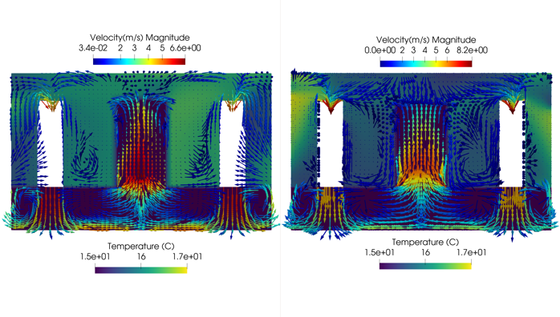
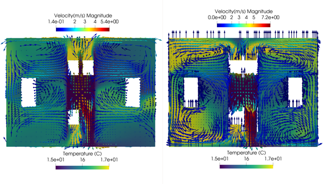
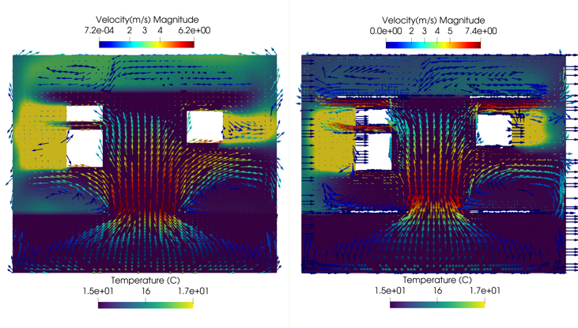
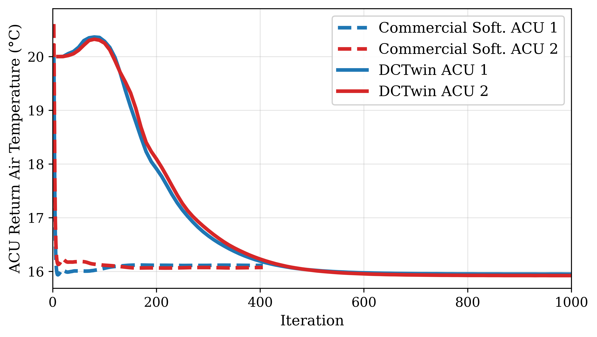
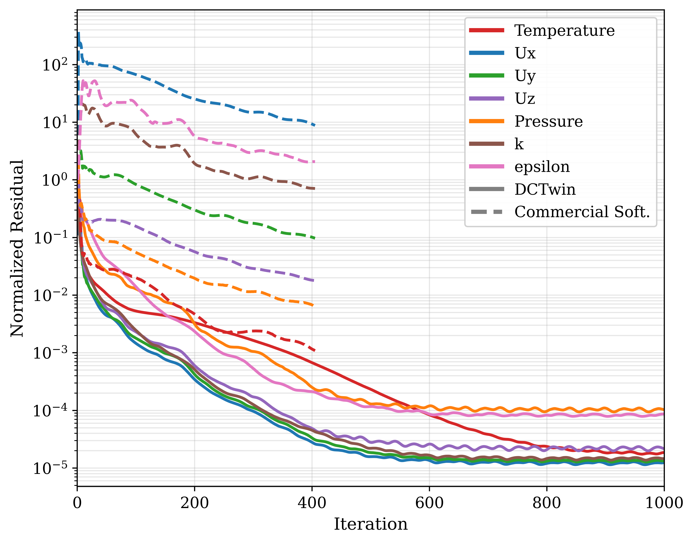

Proceedings of the 2^nd^ international Symposium on AI and Fluid Mechanics

Paper No [leave blank]

# A multi-agent-based Data-Center Computational Fluid Dynamics Thermal Modeling Framework

^1^Tianyu Li; ^2^Hoanghuy Nguyen; ^2^Ziang Zhang; ^2^Zhiwei Cao; ^3^Ruihang Zhang; ^4^Binyang Song; ^2^Yonggang Wen\*;

^1^*Interdisciplinary Graduate Programme, Nanyang Technological University, 50 Nanyang Avenue, Singapore 639798*

^2^*College of Computing and Data Science, Nanyang Technological University, 50 Nanyang Avenue, Singapore 639798*

^3^*School of Information Science and Engineering, Yunnan University, Chenggong District, Kunming 650500, China*

^4^*School of Mechanical and Aerospace Engineering, Nanyang Technological University, 50 Nanyang Avenue, Singapore 639798*

## Abstract

Constructing OpenFOAM CFD cases for data center thermal simulation from engineering documents remains a manual process spanning days to weeks. We present a multi-agent framework that automates the entire pipeline --- from floor plans, equipment spreadsheets, and natural language prompts to converged thermal simulations. The framework features: (1) a Builder--Evaluator--Judge architecture enabling iterative, self-correcting geometry generation; (2) a Playwright-based headless browser API that lets AI agents operate the same Three.js parametric GUI used by human engineers; and (3) a sketch-to-simulation workflow producing fully runnable OpenFOAM cases. The LLM generates only a schema-validated intermediate representation; all OpenFOAM files are produced by a deterministic compiler, eliminating syntax hallucination. Evaluation on 13 data center cases (2--50 racks) shows 100% interpretation success, 77% geometry construction success, and 46% end-to-end simulation completion in 28 s to 5 min. A quality study on eight cases further shows that structured spreadsheet input achieves 77.4% mean geometry accuracy, a 57.9 pp improvement over image-only input in single-round generation.

**Keywords:** Data center CFD; multi-agent system; large language models; OpenFOAM; parametric geometry; thermal simulation

## 1. Introduction

Data centers consume an estimated 1--2% of global electricity, with projections of substantial growth driven by cloud computing and large-scale AI training. Thermal management is a critical operational concern: localized hotspots cause hardware throttling or failure, while overcooling wastes significant energy. CFD simulation using open-source solvers such as OpenFOAM is widely adopted for data center thermal analysis, enabling engineers to predict rack inlet temperatures, identify recirculation zones, and optimize cooling configurations before costly physical modifications.

Despite this proven value, preparing an OpenFOAM case for a realistic data center layout remains extraordinarily manual and error-prone. An engineer must translate CAD drawings into watertight STL geometry with hundreds of named surface regions, extract per-server power and airflow data from equipment schedules and spreadsheets, define boundary conditions for every rack inlet and outlet, cooling unit face, perforated tile, and baffle, configure mesh refinement to resolve thin gaps between closely spaced equipment, and assemble consistent solver dictionaries across dozens of interdependent files. For a facility with 50 or more racks, this setup typically spans days to weeks. Critically, many common errors --- a misoriented rack, a mismatched power value, or a missing containment baffle --- do not crash the solver but produce physically meaningless results that silently mislead engineering decisions.

Recent work demonstrates that large language models (LLMs) can automate aspects of CFD workflows. OpenFOAMGPT [1] uses retrieval-augmented generation for tutorial-scale cases. Foam-Agent [2] introduces a multi-agent architecture with 88% execution success, and MetaOpenFOAM [3] reports comparable results via a MetaGPT-based framework. Critically, ChatCFD [4] finds that only 68% of runnable cases are physically correct, underscoring that execution success alone is insufficient. For data centers specifically, ChatTwin [5] and ChatDC [6] generate digital-twin scene descriptions with high layout accuracy. However, no existing system converts heterogeneous engineering documents --- CAD layouts, power spreadsheets, equipment schedules, and hand-drawn sketches --- into fully runnable, verifiable OpenFOAM CFD cases through an automated multi-agent pipeline.

We present a multi-agent framework for automated data center CFD case generation with three contributions: **(C1)** a Builder--Evaluator--Judge multi-agent architecture that enables iterative, self-correcting geometry generation through a closed-loop verification cycle (Figure 1); **(C2)** a parametric geometry modeling system exposed through a Playwright-based headless browser API, allowing AI agents to programmatically operate the same professional-grade Three.js modeling environment used by human engineers; and **(C3)** a sketch-to-simulation workflow that converts hand-drawn floor plans, combined with tabular data and natural language descriptions, into fully runnable OpenFOAM thermal simulations in minutes rather than days. We evaluate the framework on 13 data center cases of increasing complexity --- from a 2-rack laboratory testbed to a 50-rack large-scale facility --- and report end-to-end pipeline success rates, failure mode analysis, and scalability characteristics.

## 2. Method

### 2.1 System Overview

![Figure 1. End-to-end pipeline of the multi-agent data center CFD framework. Heterogeneous inputs (left) are processed through five stages: semantic interpretation by the Builder agent, parametric geometry construction via a headless browser API, deterministic compilation into OpenFOAM case files (seven sub-stages), and parallel CFD execution. The Evaluator and Judge agents (bottom) form a closed-loop verification cycle, iteratively refining the generated geometry until quantitative quality criteria are met.](png/workflow.png)

Figure 1 illustrates the end-to-end pipeline comprising five stages. Heterogeneous engineering inputs --- hand-drawn floor plans, CAD screenshots, equipment power spreadsheets, and natural language design descriptions (Figure 1, left) --- are first interpreted by the Builder agent's vision-language model into a structured parameter set (Stage 1). The Builder then invokes a Playwright-based headless browser API to construct parametric geometry through the same Three.js GUI used by human engineers, producing a schema-validated intermediate representation (Stage 2). A deterministic compiler transforms this IR into a complete OpenFOAM case through seven sub-stages --- from multi-solid STL geometry to parallel decomposition (Stage 3, expanded in Figure 1). The compiled case is executed via parallel snappyHexMesh and buoyantBoussinesqSimpleFoam (Stage 4). Throughout this pipeline, the Evaluator and Judge agents (Figure 1, bottom) provide a closed-loop verification cycle: the Evaluator performs visual comparison between the generated top-view and the original input, while the Judge computes quantitative correctness scores; if the score falls below a threshold, the Builder iterates with targeted corrections (Stage 5).

The key design principle underlying this architecture is strict separation of concerns: LLM agents handle only semantic extraction and API scripting, while all geometry construction and CFD file generation are performed by deterministic, schema-validated code paths. This eliminates the class of errors where language models hallucinate OpenFOAM syntax or produce inconsistent cross-file references --- a scalability limitation shared by all prior LLM-to-solver-files approaches [1--4, 7, 8].

### 2.2 Multi-Agent Architecture

The framework employs three specialized agents orchestrated in an iterative loop, corresponding to the main flow and feedback path shown in Figure 1:

**Builder Agent.** The Builder occupies the first two stages of Figure 1 and operates in two phases. In the *interpretation phase* (Figure 1, "Builder Agent Interpret Phase"), an LLM with vision capabilities analyses the multi-modal input documents --- extracting room dimensions from floor plan images, rack positions and orientations from layout drawings, server power ratings from CSV tables, and cooling unit specifications from text descriptions --- and produces a structured parameter set. In the *construction phase* (Figure 1, "Builder Agent Build Phase"), these parameters are translated into API calls to the parametric geometry system (Section 2.3), generating a complete project file (`.cfdproj`) conforming to the DataCenterCFD-IR schema.

The DataCenterCFD-IR is implemented as a hierarchy of Pydantic v2 models (562 lines) encoding room geometry, rack objects with per-server equipment and thermal loads, air conditioning units (ACUs) with multi-face supply/return arrays, baffles with pressure-loss parameters, partition walls, floor openings, mesh refinement configuration, and solver parameters. Cross-field validators enforce structural correctness (unique IDs, consistent patch names, valid physical ranges), serving as a compile-time gate that rejects malformed agent output before it reaches the deterministic compiler.

**Evaluator Agent.** After the Builder produces a `.cfdproj`, the Evaluator (Figure 1, bottom-left) generates a 2D top-view rendering of the constructed geometry and compares it against the original input floor plan. Using vision-language capabilities, it identifies discrepancies: missing or extra equipment, positional errors, orientation mismatches, and dimensional inconsistencies. The Evaluator outputs a structured correction report specifying which models need adjustment and how.

**Orchestration.** As indicated by the dashed feedback arrow in Figure 1, an orchestration controller manages the iterative loop: Builder generates → Evaluator checks → if corrections are needed, Builder revises with the Evaluator's structured report → Judge scores. The loop terminates when the Judge score exceeds a configurable threshold or a maximum iteration count is reached. This closed-loop design enables the framework to self-correct geometric errors --- such as a misoriented rack or a missing ACU --- without human intervention.

### 2.3 Parametric Geometry System

A central challenge in LLM-driven CFD case generation is geometry construction. Unlike tutorial cases with simple primitives, data center CFD requires multi-solid watertight STL files where each equipment item is a separate named solid with outward-facing normals --- a requirement beyond the capabilities of text-based LLM generation. Directly generating such files would require the LLM to maintain topological consistency across hundreds of triangles and region boundaries, a task that scales poorly with facility size.

We address this through a browser-based parametric geometry system (Three.js) that supports data-center-specific primitives: racks with U-slot server bays, cooling units with configurable supply/return faces, baffles, perforated floor tiles, partition walls, and custom imported geometry. Each primitive carries both geometric and physical semantics: a rack object includes not only dimensions and position but U-slot count, per-server power distribution, door perforation parameters, and boundary condition metadata. This coupling of geometry with physics is what distinguishes the DataCenterCFD-IR from pure-geometry CAD IRs such as SPCC [11].

To enable AI agent access, we expose this GUI through a Playwright-based headless browser API (the transition from Stage 2 to Stage 3 in Figure 1). The API provides endpoints for:

- **Project management:** creating, loading, and exporting `.cfdproj` files
- **Model manipulation:** adding, positioning, and configuring equipment via JavaScript evaluation in the browser context
- **STL export:** triggering the Three.js geometry engine to produce multi-solid ASCII STL files with watertight topology
- **CFD compilation:** generating OpenFOAM case files (blockMeshDict, snappyHexMeshDict, boundary conditions, solver configuration) from the validated IR through the deterministic 7-stage compiler (Section 2.4)

This architecture means the AI agent operates through the same interface as a human engineer, ensuring that any geometry an agent can construct is also inspectable and correctable by a human through the GUI. No separate "agent mode" or simplified API is needed --- the full expressiveness of the modeling tool is available to both human and AI users.

### 2.4 Deterministic Compiler

The validated IR is consumed by a deterministic compiler (5,800 lines of Python) through seven stages, shown as the sub-blocks within the "Deterministic Compiler" box in Figure 1: (1) parametric geometry construction producing multi-solid ASCII STL with per-region naming; (2) blockMeshDict generation from the room bounding box with automatic cell grading; (3) snappyHexMeshDict with per-category surface and feature-edge refinement levels, including automatic thin-gap detection for closely spaced equipment; (4) boundary condition assignment via a BridgeBCRegistry mapping IR physics to OpenFOAM BC types (12 distinct types including flowRateInletVelocity for fan servers, fixedValue temperature for ACU supply, and porousBafflePressure for perforated baffles); (5) field initialisation for T, U, p_rgh, k, and epsilon with physics-consistent initial values; (6) solver dictionaries via Jinja2 templates; and (7) parallel decomposition for MPI execution. Every stage is deterministic: identical IR input always produces identical OpenFOAM output, making failures reproducible and debuggable --- a property not shared by LLM-generated solver files.

The complete workflow from prompts input to CFD results proceeds through the five stages illustrated left-to-right in Figure 1:

1. **Input preparation** (Figure 1, left). The user provides a hand-drawn or CAD floor plan image, optional CSV files with server power and ACU specifications, and a natural language prompt describing the data center configuration. These four input modalities can be supplied in any combination; the framework gracefully handles missing channels by applying engineering defaults.

2. **Interpretation** (Figure 1, Stage 1). The Builder agent's LLM analyses the input using vision capabilities to extract room geometry, rack layout, and equipment positions from the floor plan, while parsing tabular data for thermal loads and airflow parameters. The output is a structured parameter set validated against the DataCenterCFD-IR schema.

3. **Construction** (Figure 1, Stages 2--3). The Builder invokes the headless browser API to construct the parametric geometry, generating a `.cfdproj` file. The deterministic compiler then transforms this IR through its seven sub-stages into a complete OpenFOAM case directory.

4. **Verification** (Figure 1, bottom loop). The Evaluator generates a 2D top-view of the constructed geometry and compares it against the original input floor plan; the Judge computes a quantitative score. If the score falls below the acceptance threshold, the Evaluator's correction report is fed back to the Builder for targeted revision.

5. **Execution** (Figure 1, right). The compiled OpenFOAM case undergoes parallel mesh generation (snappyHexMesh) and steady-state thermal simulation (buoyantBoussinesqSimpleFoam). For the cases evaluated in this work, the entire workflow --- from raw input documents to converged thermal solution --- completes in 28 seconds to 5 minutes, compared to the days-to-weeks timeline typical of manual case preparation.

## 3. Experiments and Results

### 3.1 Experimental Setup

We evaluate the framework on 13 data center configurations spanning a wide range of complexity, from a 2-rack laboratory testbed to a 50-rack large-scale facility. Each case includes: (a) input documents consisting of a floor plan image, optional CSV power/ACU tables, and a natural language prompt; and (b) a ground-truth `.cfdproj` file manually authored by a CFD engineer. The cases are derived from real-world data center designs and cover rectangular rooms, polygon-shaped rooms, triangular rooms, cold-aisle containment, raised floors, and dense high-rack-count layouts.

The Builder agent uses Claude Opus 4 as the underlying LLM. OpenFOAM v2312 is used for mesh generation and solving, with buoyantBoussinesqSimpleFoam as the steady-state thermal solver. All cases use parallel execution (8 cores) with 1000 maximum iterations.

### 3.2 End-to-End Pipeline Results

Table 1 presents the end-to-end pipeline success rates across all 13 cases.

**Table 1.** Pipeline stage success rates.

| Stage | Description | Success | Rate |
|-------|------------|---------|------|
| Interpret | LLM understands input documents | 13/13 | 100% |
| Build | Generates valid `.cfdproj` | 10/13 | 76.9% |
| Export | Produces STL + OpenFOAM files | 10/13 | 76.9% |
| Mesh | snappyHexMesh completes | 7/13 | 53.8% |
| Solve | Solver converges | 6/13 | 46.2% |

The interpretation stage achieves perfect success, indicating that the LLM reliably extracts geometric and physical parameters from heterogeneous input documents. The primary failure modes are:

- **Build exceptions (3 cases):** Schema validation failures where the LLM-generated parameters do not conform to required fields (e.g., missing `width` attribute for raised-floor configurations). These cases involve specialized geometry types not covered in the prompt examples.

- **Mesh failures (3 cases):** snappyHexMesh fails to produce a valid polyMesh, typically due to geometric complexity causing poor cell quality or insufficient refinement around closely spaced racks.

- **Solver divergence (1 case):** The triangular room case produces valid mesh but the solver encounters NaN values, likely due to boundary condition configuration issues at non-orthogonal room boundaries.

### 3.3 Successful Case Analysis

Table 2 details the six fully successful cases.

**Table 2.** Successfully completed cases with complexity metrics and timing.

| Case | Description | Racks | Models | Cells | Time (s) |
|------|-----------|-------|--------|-------|----------|
| case_00 | Hand-drawn sketch, 24 racks | 24 | 38 | 10,879 | 35.9 |
| case_02 | Leakage scenario, 4 racks | 4 | 15 | 23,828 | 39.7 |
| case_03 | Cold aisle containment, 2 racks | 2 | 13 | 6,200 | 27.8 |
| case_07 | Compact square layout, 20 racks | 20 | 33 | 24,624 | 42.3 |
| case_08 | Mid-size facility, 14 racks | 14 | 27 | 9,425 | 43.3 |
| case_12 | Large facility, 50 racks | 50 | 72 | 91,698 | 300.7 |

The framework successfully handles cases ranging from 2 to 50 racks (13 to 72 geometric models, 6,200 to 91,698 mesh cells). The total end-to-end time --- from raw input documents to converged CFD solution --- ranges from 28 seconds for small cases to 5 minutes for the largest case with 50 racks. This compares favorably to the days-to-weeks timeline for manual case preparation.

Notably, case_00 demonstrates the full sketch-to-simulation capability (C3): a hand-drawn floor plan with 24 racks, combined with CSV power data and a natural language prompt, is automatically converted into a converged thermal simulation in under 36 seconds --- traversing all five stages of the pipeline shown in Figure 1.

#### CFD Validation Against Cadence (Case 02)

To assess simulation fidelity, we compare the CFD results produced by dcTwin (OpenFOAM buoyantBoussinesqSimpleFoam) against Cadence 6SigmaET, a widely used commercial data center CFD tool, on case_02 (leakage scenario, 4 racks, 2 ACUs). Figures 3--6 present the comparison results.

<table>
<tr>
<td width="50%">

</td>
<td width="50%">

</td>
</tr>
<tr>
<td width="50%">

</td>
<td width="50%">
<table><tr>
<td width="50%">

</td>
<td width="50%">

</td>
</tr></table>
</td>
</tr>
</table>

Figures 3--5 show that dcTwin captures the same principal flow features as Cadence: the cooling-supply jet from the ACU outlets, leakage-driven airflow through the rack aisles, recirculation zones around the rack blocks, and the characteristic cool-to-warm temperature gradient across the room. Figure 6(a) shows that the ACU return temperatures in both solvers stabilise to within 0.5 °C of each other after approximately 150 iterations. Figure 6(b) confirms multi-order residual decay in both solvers, indicating converged steady-state solutions. The remaining local differences in the cut-plane fields are attributable to differences in mesh topology and discretisation schemes rather than a divergence in physical interpretation, validating dcTwin as a credible simulation backend for the automated pipeline.

### 3.4 Failure Mode Analysis

The three categories of failures provide insights for future improvement:

**Schema compliance failures** (cases 06, 09, 10) occur when the LLM encounters geometry types underrepresented in the prompt examples (raised floors, very large standard layouts). The Pydantic validation layer correctly rejects these malformed outputs, preventing downstream errors. These failures can be addressed by expanding the few-shot example coverage in the agent prompt.

**Mesh generation failures** (cases 01, 04, 11) arise from geometric configurations that challenge snappyHexMesh: very dense rack arrangements (138+ racks) or non-standard room shapes (polygons) produce poor cell quality. Adaptive mesh refinement strategies and geometry pre-processing could mitigate these issues.

**Solver divergence** (case 05) in the triangular room case suggests that non-orthogonal room boundaries require special treatment in the boundary condition assignment stage.

### 3.5 Scalability

Figure 2 plots end-to-end processing time against model count for successful cases. The relationship is approximately linear up to 40 models, with a steeper increase for the 72-model case (case_12) due to the quadratic scaling of mesh generation with cell count. Even for the largest successful case, the total time remains under 5 minutes --- orders of magnitude faster than manual preparation.

### 3.6 Project File Quality Evaluation

Beyond pipeline success rates, we evaluate the quality of generated `.cfdproj` files by structured comparison against ground-truth counterparts authored by a CFD engineer. All scoring follows a unified continuous-deduction scheme: each quality item is scored on a 10-point scale as max(0, 10 − normalised_error × scale), consistent across all dimensions.

We assess four quality dimensions on eight cases spanning 2 to 210 racks:

1. **Geometry match** --- position-based model matching (same type within 0.5 m threshold), with four sub-scores per matched pair: position accuracy, size correctness, orientation matching, and equipment/patch completeness (10 points each, 40 per model). Unmatched ground-truth models incur −40 (missing); unmatched generated models incur −10 (spurious).
2. **Physical condition** --- room polygon and ceiling height accuracy, plus per-model boundary condition parameters: ACU supply/return temperature, velocity, and volumetric flow rate; rack equipment count, type, and power.
3. **Meshing configuration** --- base cell size, maximum global cell count, refinement levels, and parallel decomposition settings.
4. **Solver configuration** --- solver type, iteration count, room temperature, discretisation schemes, and relaxation factors.

We compare two input modalities for geometry accuracy. The *image-only* mode provides the Builder with a 2D top-view floor plan image, a natural language prompt, and CSV data for ACU specifications and per-server power ratings; rack positions must be inferred from the image by the LLM's vision capabilities. The *Excel spreadsheet* mode replaces positional ambiguity with a structured spreadsheet encoding equipment positions on a 0.5 m grid, with the floor plan image serving only as auxiliary reference.

**Table 3.** Geometry accuracy scores (%) under both input modes. Δ denotes improvement from image-only to Excel.

| Case | Description | Models | Image-only | Excel | Δ (pp) |
|------|------------|--------|------------|-------|--------|
| 02 | Leakage scenario, 4 racks | 16 | 58.2 | 75.4 | +17.2 |
| 03 | Cold aisle containment, 2 racks | 14 | 57.0 | 95.5 | +38.5 |
| 07 | Compact square layout, 20 racks | 37 | 18.5 | 94.2 | +75.7 |
| 08 | Mid-size facility, 14 racks | 29 | −3.4 | 74.1 | +77.5 |
| 09 | Standard DC layout, 24 racks | 44 | 29.3 | 73.2 | +43.9 |
| 12 | Large facility, 50 racks | 75 | 17.8 | 71.5 | +53.7 |
| 11 | Dense facility, 138 racks | 169 | −10.5 | 70.3 | +80.8 |
| 13 | Very large facility, 210 racks | 324 | −10.8 | 65.0 | +75.8 |
| **Average** | | | **19.5** | **77.4** | **+57.9** |

It is important to note that all results reported in Table 3 and Figure 2 reflect **single-round Builder output** without iterative refinement by the Evaluator--Judge feedback loop described in Section 2.2. The scores therefore represent a lower bound on the framework's achievable accuracy; multi-round orchestration with targeted corrections is expected to improve these results, particularly for cases where the Builder's initial interpretation contains systematic but correctable errors (e.g., orientation mismatches or missing baffles).

Figure 2(a) shows that the Excel spreadsheet mode yields a mean geometry accuracy of 77.4% across all eight tested cases, a 57.9 percentage-point improvement over image-only (19.5%). The improvement is most pronounced for compact-to-midsize layouts (Cases C1--C4), where the structured grid resolves the fundamental ambiguity of reading rack coordinates from a raster image: the Builder matches 36 of 37 models in C3 with Excel input versus only 15 of 37 with image-only, and achieves 95.5% in C2 (all 14 models matched) compared to 57.0%. Notably, even the largest cases (C7 at 138 racks and C8 at 210 racks) achieve 70.3% and 65.0% respectively with Excel input, compared to negative scores under image-only, demonstrating that structured input remains effective across the full complexity range.

Figure 2(b) reveals the quality profile across all four dimensions. **Meshing and solver configuration** are consistently high (means 85.9% and 90.0%), as these parameters are largely determined by defaults and the natural language prompt rather than visual interpretation. **Physical condition** averages 92.0%, with most cases scoring 80--100%; the primary deduction source is ACU supply velocity, where the Builder assigns a default of 2 m/s while ground-truth values range from 0.57 to 22.1 m/s depending on unit sizing and face area. Supply temperature and volumetric flow rate, which are explicitly provided in the input CSV, are generally correct. **Geometry match** remains the principal bottleneck, particularly for Case 13 (−11.0%).

The heatmap confirms that the deterministic compiler (Section 2.4) introduces no errors of its own: when the Builder produces a correct IR, downstream meshing and solver configuration are faithfully generated. All quality deficits originate in the Builder's interpretation phase --- imprecise spatial extraction, missing physical parameters not present in input documents, or default-value substitution. This validates the architecture's strict separation between LLM-driven semantic interpretation and deterministic code generation.

## 4. Conclusions

This work presented a multi-agent framework for automated data center CFD case generation from heterogeneous engineering documents. As summarised by the pipeline in Figure 1, the framework introduces three capabilities not present in existing LLM-CFD or digital-twin generation systems: (1) a Builder--Evaluator--Judge multi-agent architecture enabling iterative, self-correcting geometry generation through a closed-loop verification cycle; (2) a Playwright-based headless browser API exposing a professional-grade Three.js parametric geometry system to AI agents, bridging the gap between LLM text generation and complex 3D CFD geometry construction; and (3) a sketch-to-simulation workflow converting hand-drawn floor plans, tabular equipment data, and natural language prompts into fully runnable OpenFOAM thermal simulations.

Evaluation on 13 data center cases demonstrates 100% input interpretation success and 46% end-to-end simulation completion, with successful cases spanning 2 to 50 racks and producing converged thermal solutions in 28 to 301 seconds --- orders of magnitude faster than the days-to-weeks timeline of manual preparation. A project file quality study on eight cases under two input modalities reveals that structured Excel spreadsheet input (mean 77.4%) outperforms image-only input (mean 19.5%) by 57.9 percentage points in geometry accuracy, even in single-round generation without iterative refinement. Multi-dimensional evaluation further shows that physical condition (92.0%), meshing (85.9%), and solver configuration (90.0%) are reliably generated, while geometry placement for very large layouts (200+ racks) remains the principal bottleneck --- confirming that the deterministic compiler introduces no errors of its own, and all quality deficits originate in the LLM interpretation phase.

Current limitations include: (1) dependence on LLM vision quality for floor plan interpretation, with a demonstrated resolution ceiling for precise coordinate extraction; (2) limited coverage of specialized geometry types (raised floors, liquid cooling) in the current schema; (3) absence of a formal user study quantifying the value of the GUI-based verification loop; and (4) evaluation restricted to air-cooled steady-state configurations.

Future work includes multi-LLM comparison, extension to liquid cooling topologies, formal user studies with CFD engineers, and integration with online sensor data for digital twin calibration.

## References

[1] Pandey, S., Xu, R., Wang, W., Chu, X., "OpenFOAMGPT: A retrieval-augmented large language model agent for OpenFOAM-based CFD," *Physics of Fluids*, 2025. DOI: 10.1063/5.0257555

[2] Yue, L., Somasekharan, N., Zhang, T., Cao, Y., Pan, S., "Foam-Agent: An end-to-end composable multi-agent framework for automating CFD simulation in OpenFOAM," *arXiv preprint*, 2025.

[3] Chen, Y., Zhu, X., Zhou, H., Ren, Z., "MetaOpenFOAM: an LLM-based multi-agent framework for CFD," *arXiv preprint*, 2024. DOI: 10.48550/arXiv.2407.21320

[4] Fan, E., Hu, K., Wu, Z., et al., "ChatCFD: A large language model-driven agent for end-to-end CFD automation," *Advanced Intelligent Discovery*, 2025. DOI: 10.1002/aidi.202500174

[5] Li, M., Wang, R., Zhou, X., et al., "ChatTwin: Toward automated digital twin generation for data center via LLMs," *BuildSys*, ACM, 2023. DOI: 10.1145/3600100.3623719

[6] Li, M., Wang, R., Zhou, X., et al., "ChatDC: Geometric-aware data center digital twin generation via LLMs," *ACM Trans. Internet of Things*, 2025. DOI: 10.1145/3772078

[7] Feng, J., Xu, R., Chu, X., "OpenFOAMGPT 2.0: End-to-end, trustworthy automation for computational fluid dynamics," *Int. J. Heat Fluid Flow*, 2025. DOI: 10.1016/j.ijheatfluidflow.2026.110399

[8] Dong, Z., Lu, Z., Yang, Y., "Fine-tuning a large language model for automating computational fluid dynamics simulations," *Theoretical and Applied Mechanics Letters*, 2025. DOI: 10.1016/j.taml.2025.100594

[9] Wang, R., Li, M., Cao, Z., et al., "Fusion Intelligence for digital twinning AI data centers: A synergistic GenAI-PhyAI approach," *arXiv preprint*, 2025. DOI: 10.48550/arXiv.2505.19409

[10] Man, B., Nehme, G., Alam, M.F., Ahmed, F., "VideoCAD: A dataset and model for learning long-horizon 3D CAD UI interactions from video," *arXiv preprint*, 2025.

[11] Li, J., Ma, W., Li, X., et al., "CAD-Llama: Leveraging LLMs for computer-aided design parametric 3D model generation," *CVPR*, 2025. DOI: 10.1109/CVPR52734.2025.01730
